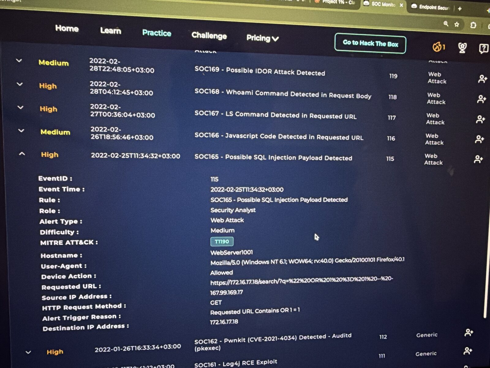
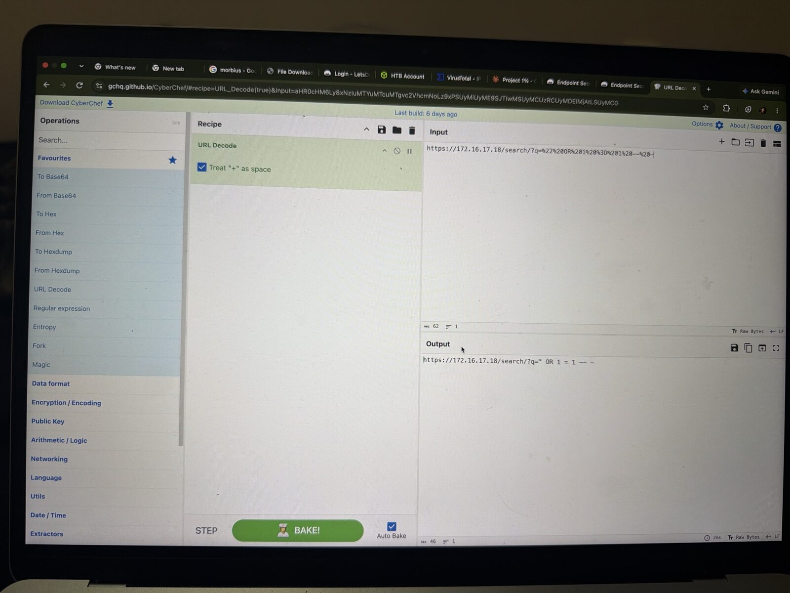
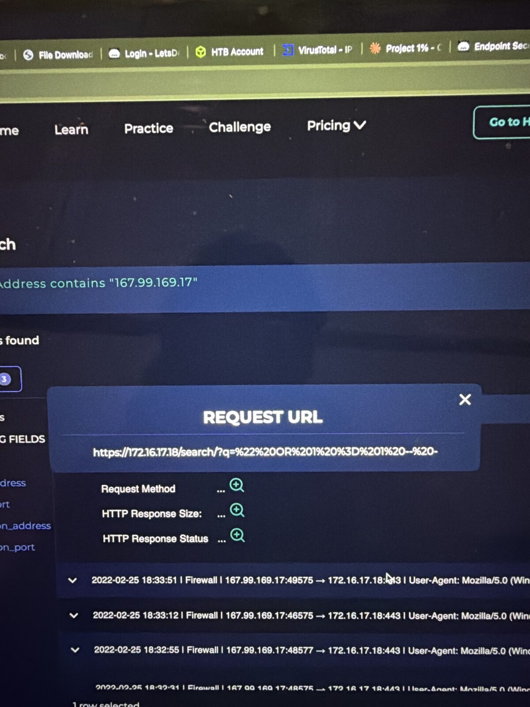
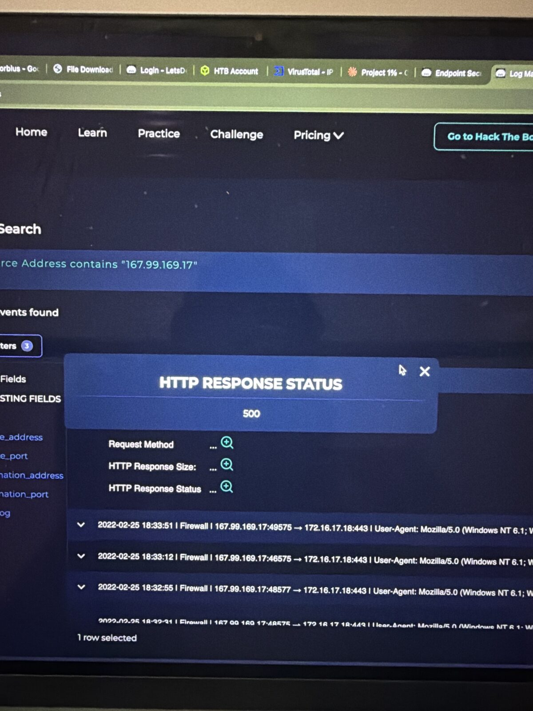
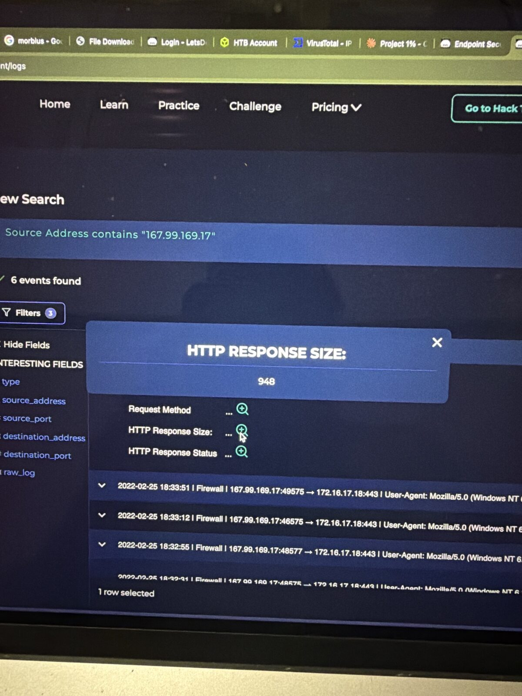
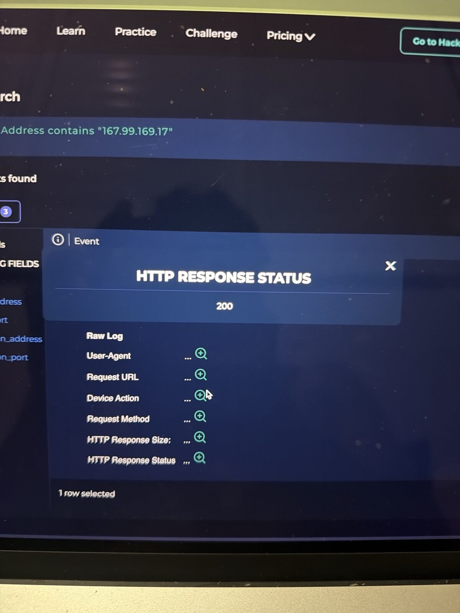
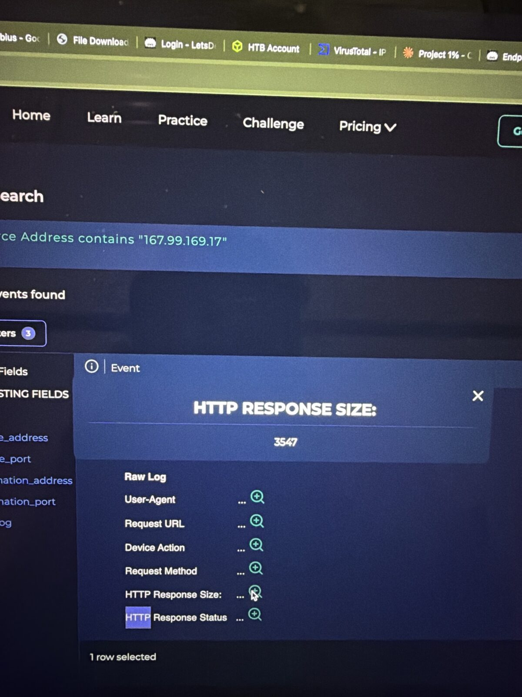

# SOC165 – Possible SQL Injection Payload Detected

**Platform:** LetsDefend SOC Simulator | **Event ID:** 115 | **Severity:** High | **Difficulty:** Medium
**Analyst:** Sidharth V Nambiar | **Verdict:** ✅ True Positive (attack attempted, **unsuccessful**, no escalation)

---

## Summary
An external IP sent SQL injection payloads to the company web server's `/search` endpoint. Every injection attempt returned **HTTP 500** with an identical **948-byte** response, so no data was returned and the attack failed.

## Alert details

| Field | Value |
|---|---|
| Event time | 2022-02-25 11:34:32 (+03:00) |
| Source IP | 167.99.169.17 |
| Destination | WebServer1001 / 172.16.17.18 |
| Method | GET |
| Requested URL | `https://172.16.17.18/search/?q=%22%20OR%201%20%3D%201%20--%20-` |
| Trigger | Requested URL contains `OR 1 = 1` |
| Device action | Allowed |
| MITRE | T1190 |

## Investigation

### 1. Decode the payload (CyberChef → URL Decode)
`/search/?q=" OR 1 = 1 -- -`
- `"` closes the original string
- `OR 1 = 1` makes the WHERE clause always true, so it would return every row
- `-- -` comments out the rest of the query

### 2. Log Management (source 167.99.169.17): 6 events

| Time | Request | Status | Size | Meaning |
|---|---|---|---|---|
| 18:30:15 | `https://172.16.17.18/` | 200 | 3547 | Normal homepage visit (recon) |
| 18:32–18:33 (×5) | SQL injection payloads on `/search/?q=` | **500** | **948** | Server error, same error page every time |

### 3. Was it successful?
**No.** A successful SQL injection usually returns **200** with a **larger or varying** response size because extra data leaks out. Here every payload request returned an identical 500 error page.

### 4. Planned test?
No pentest notice found, so this is not a planned test.

## MITRE ATT&CK

| Technique | ID | Evidence |
|---|---|---|
| Exploit Public-Facing Application | T1190 | SQL injection against `/search` |
| Active Scanning / recon | T1595 | Homepage visit before attack |

## Response
- ✅ Artifacts recorded (IP and malicious URL)
- ❌ No containment or Tier 2 escalation, because the attack failed

## Recommendations
- Block `167.99.169.17` at the WAF and firewall
- Use parameterised queries / prepared statements on `/search`
- Return generic error pages, not detailed 500 errors
- Add WAF rules for common SQLi patterns

## IOCs

| Type | Value |
|---|---|
| Attacker IP | `167.99.169[.]17` |
| Malicious URL | `hxxps://172.16.17[.]18/search/?q=%22%20OR%201%20%3D%201%20--%20-` |
| Target | WebServer1001 / `172.16.17.18` |

## Lessons learned
1. **Always decode before judging.** URL encoding hides the real payload.
2. **Status code + response size decide success,** not the alert itself.
3. **Malicious ≠ successful.** A True Positive can still need no escalation.
4. **Look at the attacker's whole session,** including the recon before the attack.

## Tools used
LetsDefend SIEM (Log Management, Case Management) · CyberChef · VirusTotal · MITRE ATT&CK

## 📸 Evidence

**Alert details**

**Cyberchef decode**

**Request url**

**Status 500**

**Size 948**

**Homepage status 200**

**Homepage size 3547**

---
*Lab: LetsDefend (Hack The Box). All indicators are from a training scenario and are defanged.*
