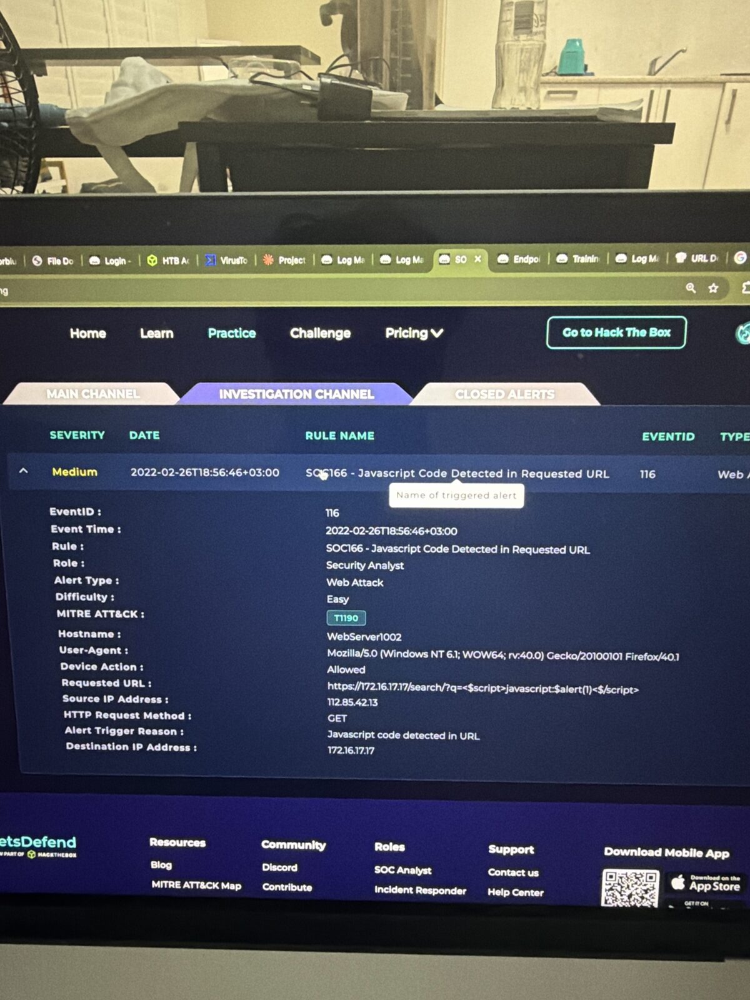
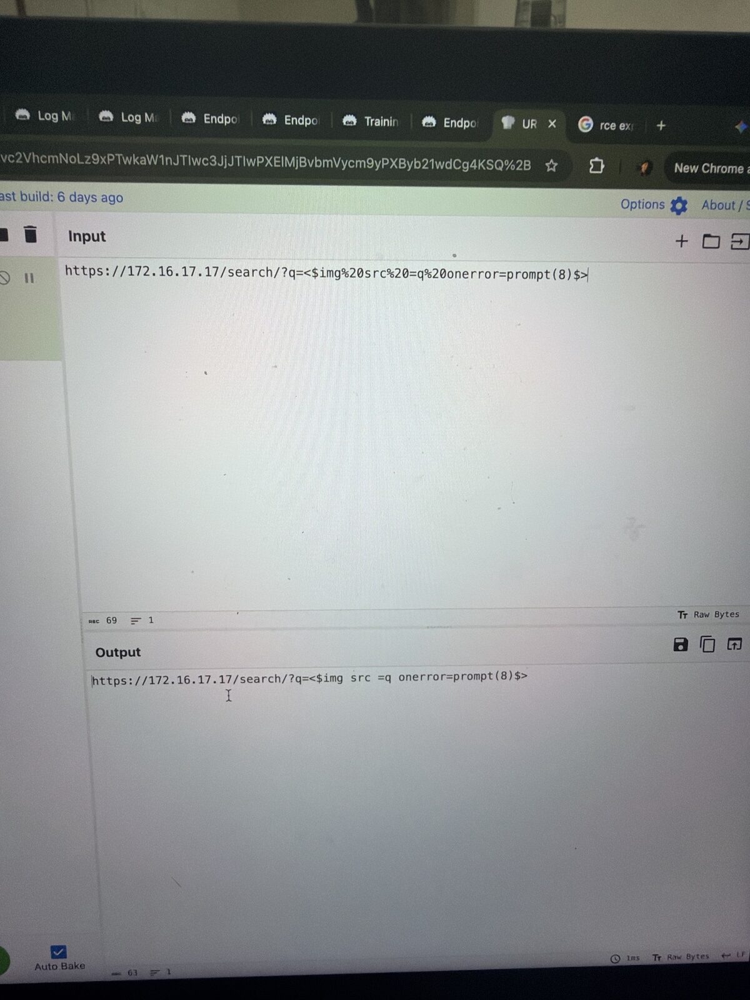
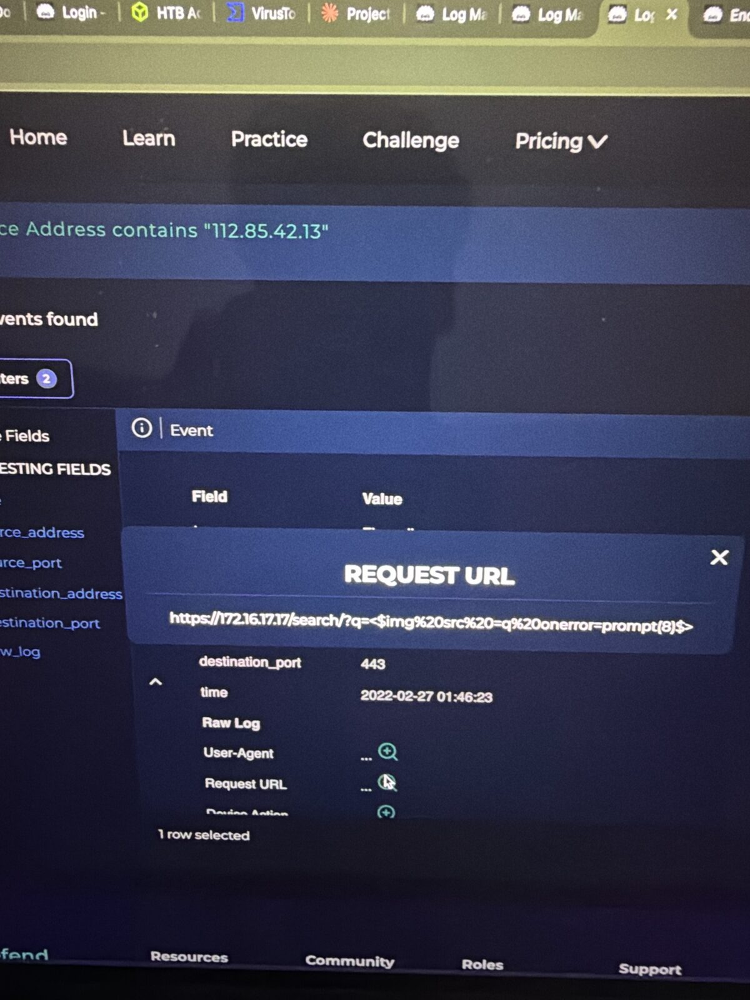
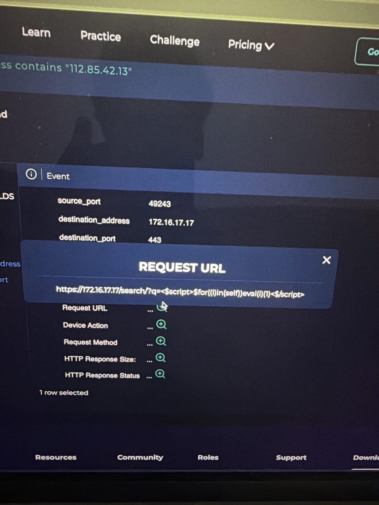
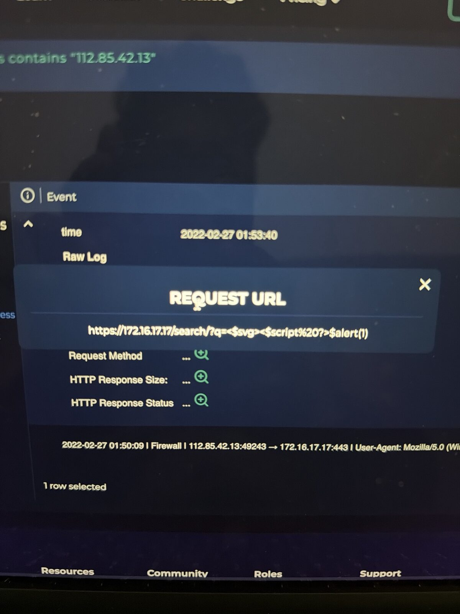
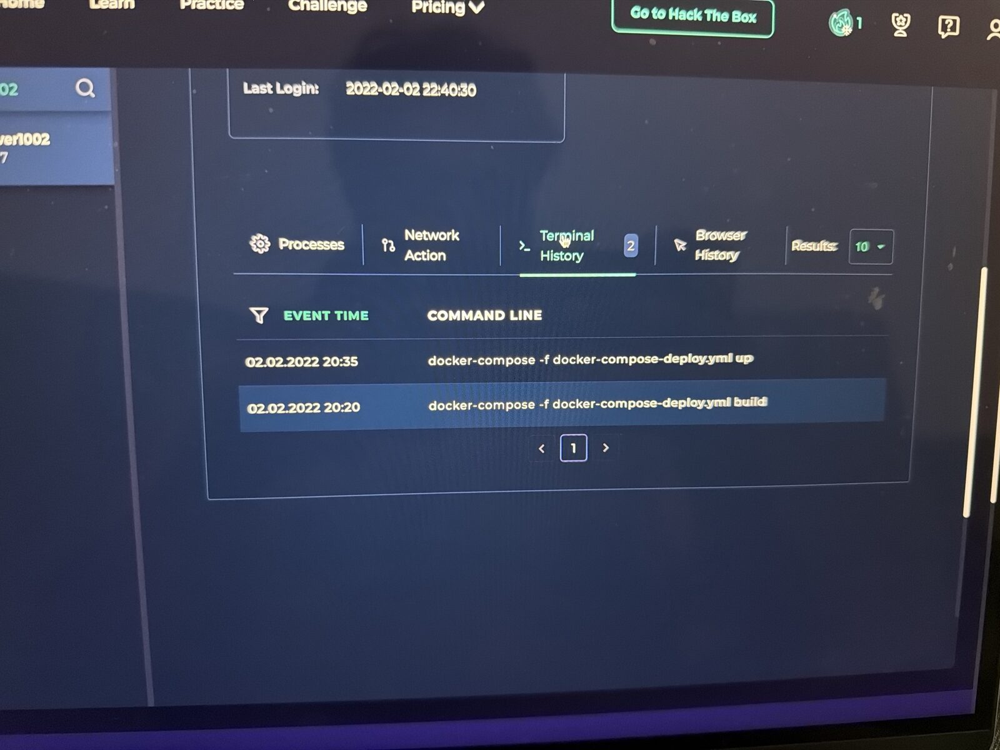

# SOC166 – Javascript Code Detected in Requested URL (XSS)

**Platform:** LetsDefend SOC Simulator | **Event ID:** 116 | **Severity:** Medium | **Difficulty:** Easy
**Analyst:** Sidharth V Nambiar | **Verdict:** ✅ True Positive (XSS attempted, **unsuccessful**, no escalation)

---

## Summary
An external IP sent a series of cross-site scripting (XSS) payloads to the `/search/` page of a company web server. Every request returned **HTTP 302** with a **0-byte** response, so the payload was never reflected back in a page and the attack failed. The endpoint showed only normal admin activity.

## Alert details

| Field | Value |
|---|---|
| Event time | 2022-02-26 18:56:46 (+03:00) |
| Source IP | 112.85.42.13 |
| Destination | WebServer1002 / 172.16.17.17 |
| Method | GET |
| Requested URL | `https://172.16.17.17/search/?q=<$script>javascript:$alert(1)<$/script>` |
| Trigger | Javascript code detected in URL |
| Device action | Allowed |
| MITRE | T1190 |

*(LetsDefend inserts `$` into tags to defang them.)*

## Investigation

### 1. Decode the payload (CyberChef → URL Decode)
`%20` is a space, so `<$img%20src%20=q%20onerror=prompt(8)$>` becomes an image tag with a broken `src` and an `onerror` handler. The broken image triggers `onerror`, which runs JavaScript in the victim's browser.

### 2. Log Management (source 112.85.42.13)
The attacker tried several XSS variants in a row, a sign of payload testing:

| Payload (defanged) | Technique | Status | Size |
|---|---|---|---|
| `<$script>javascript:$alert(1)<$/script>` | Basic script tag | 302 | 0 |
| `<$img src =q onerror=prompt(8)$>` | Event handler on broken image | 302 | 0 |
| `<$script>$for((i)in(self))eval(i)(1)<$/script>` | Obfuscated eval loop | 302 | 0 |
| `<$svg><$script ?>$alert(1)` | SVG + script filter bypass | 302 | 0 |

### 3. Was it successful?
**No.** A reflected XSS works only if the server sends the payload back inside a page (usually **200** with a size that changes). Here every request got a **302 redirect with 0 bytes**, so nothing was reflected. "Allowed" only means the firewall passed the request.

### 4. Endpoint check (WebServer1002)
Processes, network, terminal and browser history showed only normal admin work (docker-compose build/up, SSL setup). That's expected: XSS runs in visitors' browsers, not on the server.

### 5. Planned test?
No pentest notice was found, so this is not a planned test.

## MITRE ATT&CK

| Technique | ID | Evidence |
|---|---|---|
| Exploit Public-Facing Application | T1190 | XSS payloads against `/search/` |
| Drive-by Compromise (intended goal) | T1189 | Reflected XSS targets site visitors |

## Response
- ✅ Artifacts recorded (attacker IP and malicious URL)
- ❌ No containment or Tier 2 escalation, because the attack failed

## Recommendations
- Block `112.85.42.13` at the WAF and firewall
- Validate input and HTML-encode output on the search page
- Add a Content-Security-Policy header to block inline scripts
- Set cookies to `HttpOnly` so a script can't steal sessions

## IOCs

| Type | Value |
|---|---|
| Attacker IP | `112.85.42[.]13` |
| Malicious URL | `hxxps://172.16.17[.]17/search/?q=<$script>javascript:$alert(1)<$/script>` |
| Target | WebServer1002 / `172.16.17.17` |

## Lessons learned
1. **XSS targets users, not the server,** so the web logs matter more than the endpoint.
2. **Many payload variants in a row point to an attacker testing filters,** which is clearly malicious.
3. **302 + 0 bytes = not reflected = failed.**
4. **"Allowed" by the firewall ≠ successful attack.**

## Tools used
LetsDefend SIEM (Log Management, Case Management) · Endpoint Security · CyberChef · MITRE ATT&CK

## 📸 Evidence

**Alert details**

**Cyberchef decode**

**Payload img onerror**

**Payload eval loop**

**Payload svg**

**Terminal history clean**

---
*Lab: LetsDefend (Hack The Box). All indicators are from a training scenario and are defanged.*
