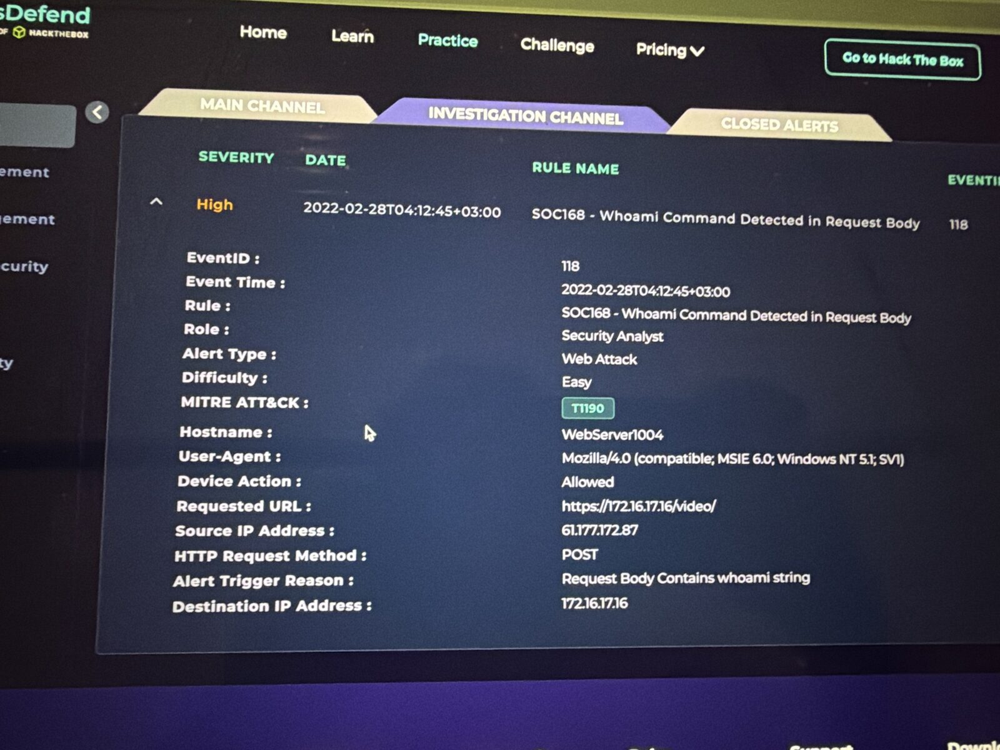
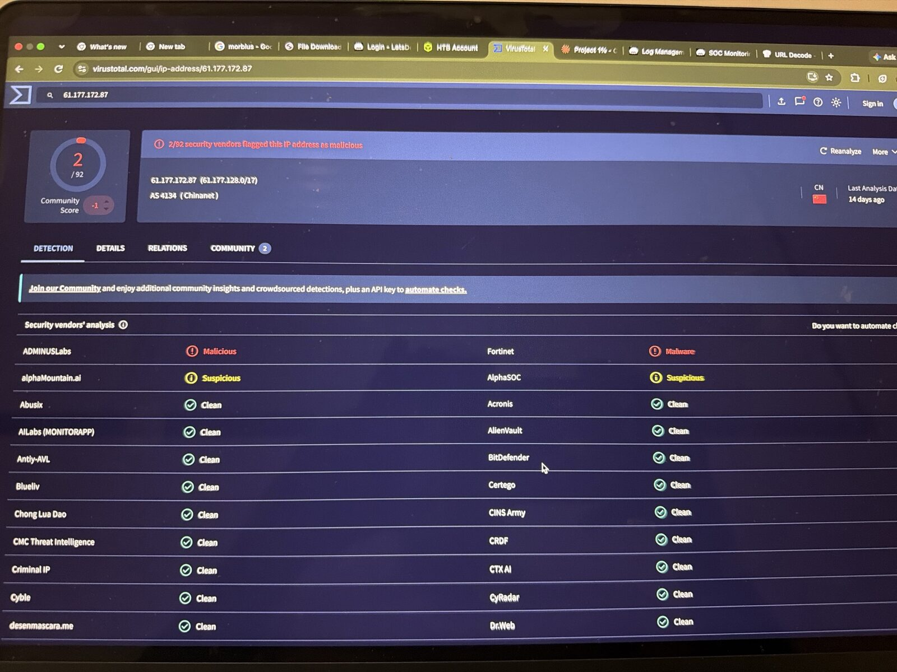
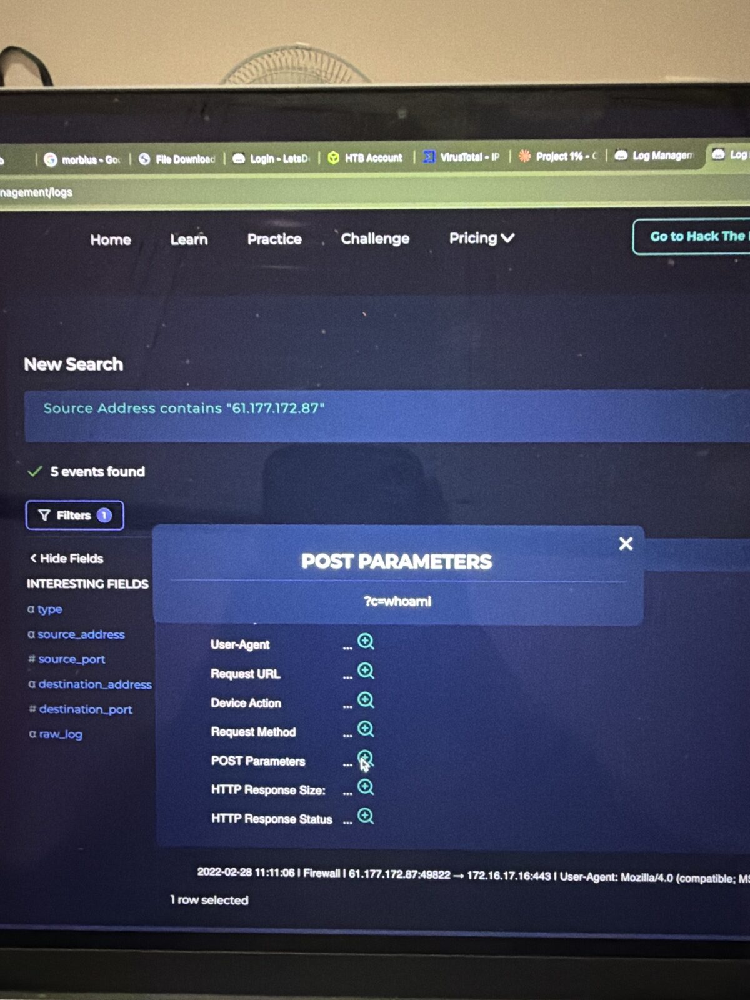
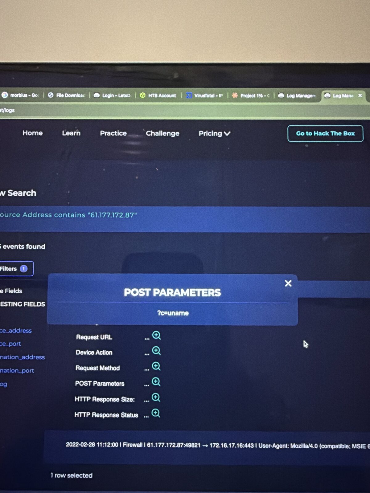
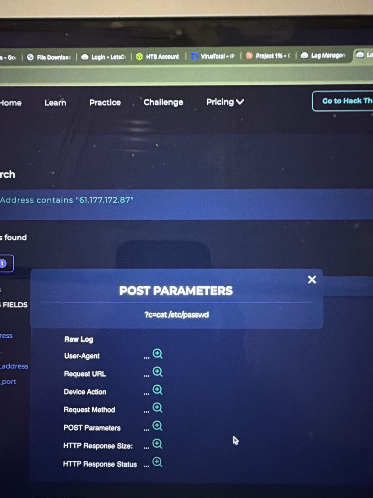
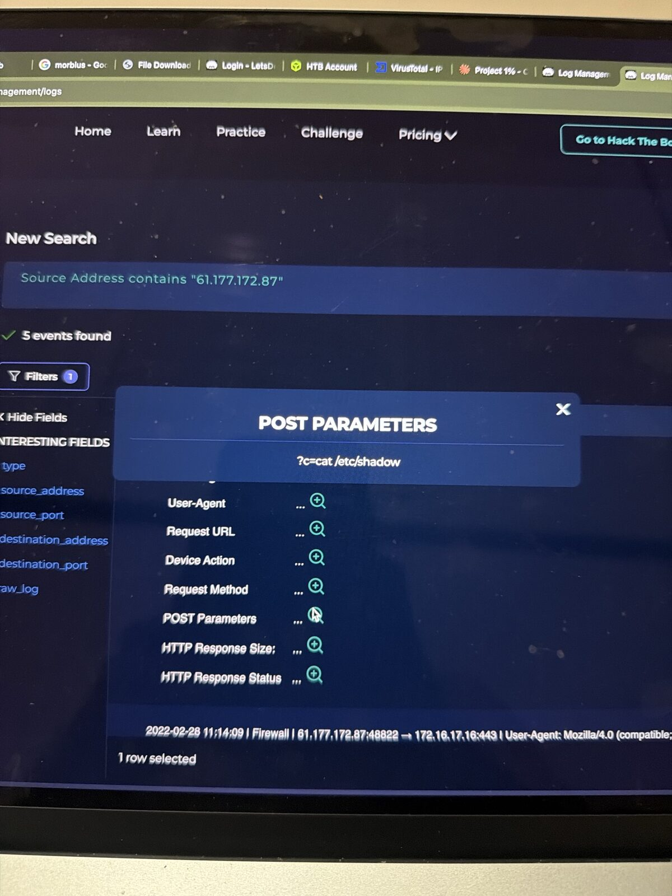
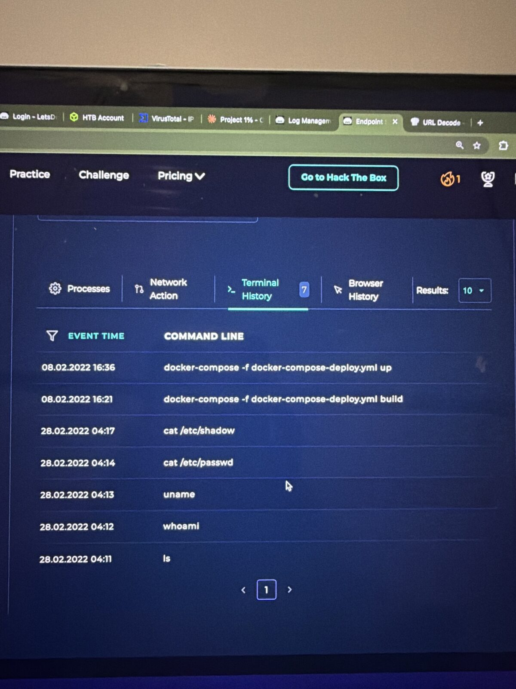

# SOC168 – Whoami Command Detected in Request Body

**Platform:** LetsDefend SOC Simulator | **Event ID:** 118 | **Severity:** High | **Difficulty:** Easy
**Analyst:** Sidharth V Nambiar | **Verdict:** ✅ True Positive (command injection **successful**, host contained, escalated)

---

## Summary
An external IP sent operating system commands in a POST parameter to a web server's `/video/` page. The server's own Terminal History shows every command was executed, including `cat /etc/shadow`, which exposes local password hashes. I contained WebServer1004 and escalated to Tier 2.

## Alert details

| Field | Value |
|---|---|
| Event time | 2022-02-28 04:12:45 (+03:00) |
| Source IP | 61.177.172.87 |
| Destination | WebServer1004 / 172.16.17.16 |
| Request | `POST https://172.16.17.16/video/` |
| Trigger | Request body contains `whoami` |
| User-Agent | `Mozilla/4.0 (compatible; MSIE 6.0; Windows NT 5.1; SV1)` (IE6 on XP, typical of a scripted tool) |
| Device action | Allowed |
| MITRE | T1190 |

## Investigation

### 1. Source IP reputation
VirusTotal **2/92** (Fortinet: malware; ADMINUSLabs: malicious); AS4134 Chinanet, China. Low score, but the endpoint evidence decides the case.

### 2. Log Management: 5 POST requests from 61.177.172.87

| Order | POST parameter |
|---|---|
| 1 | `c=ls` |
| 2 | `c=whoami` |
| 3 | `c=uname` |
| 4 | `c=cat /etc/passwd` |
| 5 | `c=cat /etc/shadow` |

A classic command injection progression: list files, check the user, check the OS, then read user and password files.

### 3. Endpoint (WebServer1004 Terminal History)

| Time (28.02.2022) | Command executed |
|---|---|
| 04:11 | `ls` |
| 04:12 | `whoami` |
| 04:13 | `uname` |
| 04:14 | `cat /etc/passwd` |
| 04:17 | `cat /etc/shadow` |

Every injected command appears in the server's shell history in the same order and minutes apart, so **the attack was successful**. (Docker and browser entries from 08.02.2022 are earlier legitimate admin activity.)

## MITRE ATT&CK

| Technique | ID | Evidence |
|---|---|---|
| Exploit Public-Facing Application | T1190 | Command injection via `/video/` |
| Command and Scripting Interpreter: Unix Shell | T1059.004 | `ls`, `cat` executed |
| System Owner/User Discovery | T1033 | `whoami` |
| System Information Discovery | T1082 | `uname` |
| OS Credential Dumping: /etc/passwd and /etc/shadow | T1003.008 | `cat /etc/shadow` |

## Response
- ✅ Contained WebServer1004
- ✅ Artifacts recorded
- ✅ Escalated to Tier 2

## Recommendations
- Block `61.177.172.87`
- Fix `/video/`: never pass user input to a shell; validate and allow-list input
- Rotate all local account passwords (hashes exposed)
- Check for persistence (new users, cron jobs, SSH keys) and further activity
- Run the web app as a low-privilege user

## IOCs

| Type | Value |
|---|---|
| Attacker IP | `61.177.172[.]87` |
| Exploited URL | `hxxps://172.16.17[.]16/video/` (POST parameter `c`) |
| Target | WebServer1004 / `172.16.17.16` |

## Lessons learned
1. **Correlate network and endpoint.** Matching request order to shell history is the strongest proof.
2. **Low IP reputation ≠ low risk.** 2/92 on VirusTotal, yet a full compromise.
3. **Reading `/etc/shadow` = credential exposure**, so passwords must be reset.
4. **Compare with SOC165:** same alert family, opposite outcome. Always prove success, never assume it.

## Tools used
LetsDefend SIEM (Log Management, EDR, Case Management) · VirusTotal · MITRE ATT&CK

## 📸 Evidence

**Alert details**

**Virustotal ip**

**Post whoami**

**Post uname**

**Post cat passwd**

**Post cat shadow**

**Terminal history proof**

---
*Lab: LetsDefend (Hack The Box). All indicators are from a training scenario and are defanged.*
