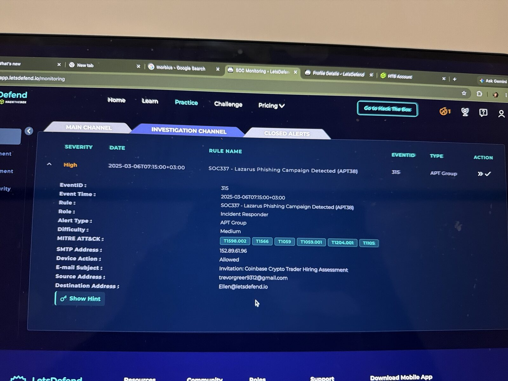
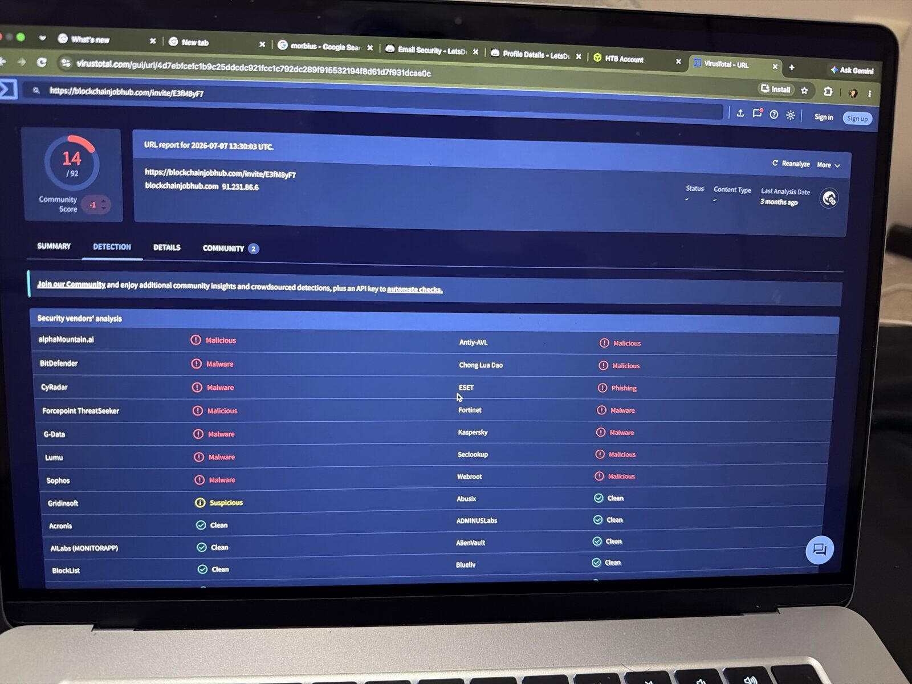
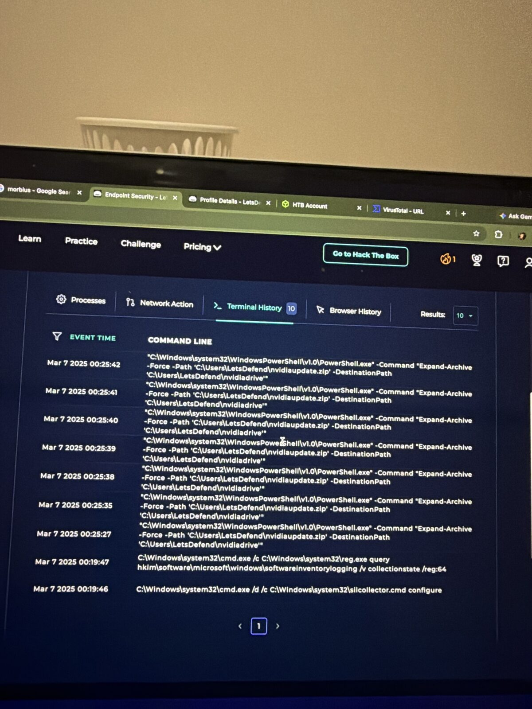
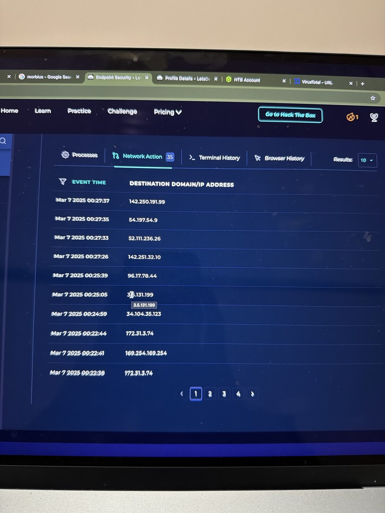
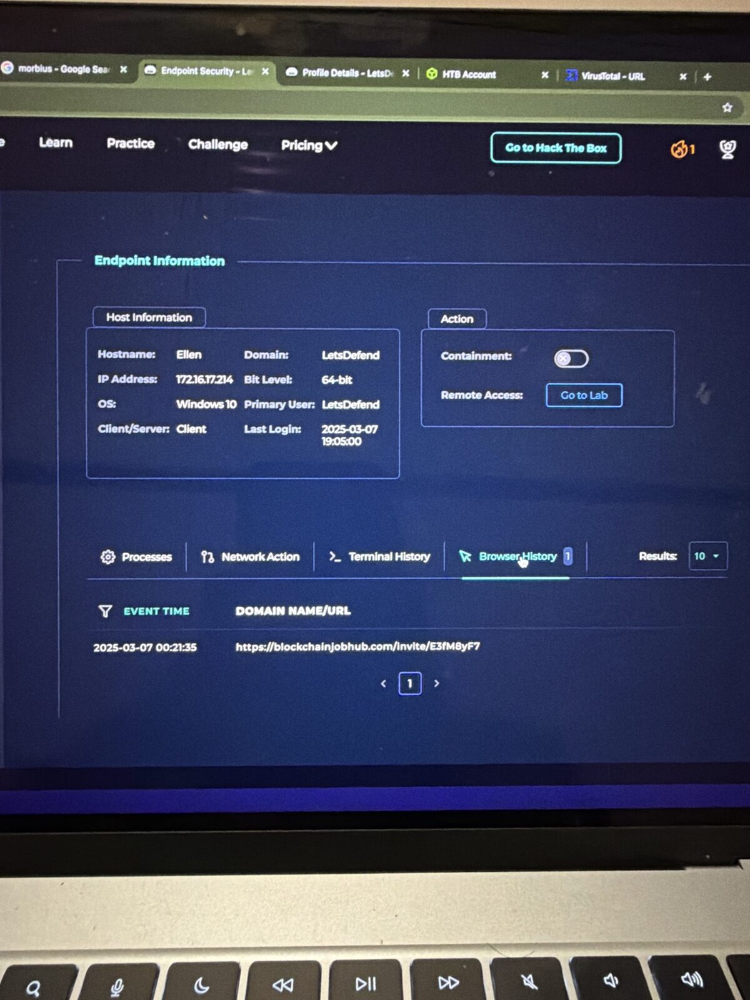

# SOC337 – Lazarus Phishing Campaign Detected (APT38)

**Platform:** LetsDefend SOC Simulator | **Event ID:** 315 | **Severity:** High | **Difficulty:** Medium
**Analyst:** Sidharth V Nambiar | **Verdict:** ✅ True Positive (host compromised, contained)

---

## Summary

A fake "Coinbase Crypto Trader Hiring Assessment" email from a real Gmail account was delivered to Ellen. She clicked a hidden link to a malicious domain, and minutes later PowerShell on her workstation extracted a payload called `nvidiaupdate.zip`. I deleted the email, contained the host, and documented the IOCs.

This matches known **Lazarus Group / APT38** tradecraft: fake job offers aimed at crypto-industry staff, followed by a fake "driver update" payload.

---

## Alert details

| Field | Value |
|---|---|
| Event time | 2025-03-06 07:15 (+03:00) |
| Rule | SOC337 – Lazarus Phishing Campaign Detected (APT38) |
| SMTP address | 152.89.61.96 |
| Sender | trevorgreer9312@gmail.com |
| Recipient | Ellen@letsdefend.io |
| Subject | Invitation: Coinbase Crypto Trader Hiring Assessment 🚀 |
| Device action | Allowed (delivered) |
| MITRE tags | T1598.002, T1566, T1059, T1059.001, T1204.001, T1105 |

---

## Investigation

### 1. Email analysis (Email Security)
- A recruitment-themed lure: "3 questions, 20 minutes, video intro", impersonating Coinbase.
- Sent from a **free Gmail account**, not a Coinbase domain.
- A **hidden "Continue" link**, styled to almost disappear into the background, pointed to:
  `hxxps://blockchainjobhub[.]com/invite/E3fM8yF7`

### 2. URL reputation (VirusTotal)
- **14/92** vendors flagged the URL as malicious, malware or phishing (Kaspersky, ESET, Sophos, BitDefender, Fortinet, G-Data and others).
- The domain resolves to **91.231.86.6**.

### 3. Header analysis (.eml in a text editor)
- `spf=pass`, `dkim=pass`, `dmarc=pass` for gmail.com
- `Received: from mail-sor-f41.google.com [209.85.220.41]`
- **Conclusion: not spoofed.** The attacker used a genuine Gmail account, so authentication checks alone would not have caught this.

### 4. Log Management (SIEM)
- Searched `raw_log contains "blockchainjobhub"` and `destination_address = 91.231.86.6` over All Time, and got **0 results**.
- Network logs did not capture the click, so I pivoted to the endpoint.

### 5. Endpoint analysis (EDR – host "Ellen", 172.16.17.214, Windows 10)

| Time (2025-03-07) | Evidence | Source |
|---|---|---|
| 00:21:35 | Visited `blockchainjobhub[.]com/invite/E3fM8yF7` | Browser History |
| 00:22–00:27 | Burst of new outbound connections | Network Action |
| 00:25:27–00:25:42 | `powershell.exe -Command "Expand-Archive -Force -Path 'C:\Users\LetsDefend\nvidiaupdate.zip' -DestinationPath 'C:\Users\LetsDefend\nvidiadrive'"` (run repeatedly) | Terminal History |

So the user **clicked the link**, a zip disguised as an NVIDIA update was downloaded, and PowerShell unpacked it.

---

## MITRE ATT&CK mapping

| Technique | ID | Evidence |
|---|---|---|
| Phishing | T1566 | Fake recruitment email |
| Phishing for Information: Spearphishing Attachment/Link | T1598.002 | Targeted "hiring assessment" lure |
| User Execution: Malicious Link | T1204.001 | Ellen opened the hidden link |
| Command and Scripting Interpreter: PowerShell | T1059 / T1059.001 | `Expand-Archive` via PowerShell |
| Ingress Tool Transfer | T1105 | `nvidiaupdate.zip` delivered to the host |

---

## Response actions
- ✅ Deleted the phishing email from the mailbox
- ✅ Contained host **172.16.17.214** via EDR
- ✅ Recorded IOCs as case artifacts

## Recommendations
- Block `blockchainjobhub[.]com` and `91.231.86.6` at the proxy, DNS and firewall
- Reimage Ellen's workstation, and reset her credentials and active sessions
- Hunt across the estate for `nvidiaupdate.zip`, the `nvidiadrive` folder and connections to the IOC IP
- Run awareness training on fake recruitment and job-offer lures

---

## IOCs

| Type | Value |
|---|---|
| URL | `hxxps://blockchainjobhub[.]com/invite/E3fM8yF7` |
| Domain | `blockchainjobhub[.]com` |
| IP (C2 / landing) | `91.231.86.6` |
| IP (SMTP, from alert) | `152.89.61.96` |
| Email sender | `trevorgreer9312@gmail[.]com` |
| File | `nvidiaupdate.zip` → `C:\Users\LetsDefend\nvidiadrive` |
| Compromised host | Ellen / `172.16.17.214` |

---

## Lessons learned
1. **SPF/DKIM pass ≠ safe.** Attackers use real free-mail accounts to get past authentication checks.
2. **Check more than one data source.** The SIEM showed nothing, and the EDR proved compromise.
3. **Hidden links are a strong phishing signal.** Always inspect the link target without clicking.
4. **Read suspicious emails as plain text,** never in a mail client.

## Tools used
LetsDefend SIEM (Monitoring, Log Management, Email Security, EDR, Case Management) · VirusTotal · TextEdit (raw .eml header analysis) · MITRE ATT&CK

## 📸 Evidence

**Alert details**

**Phishing email**

**Virustotal url**

**Terminal history**

**Network connections**

**Browser history**

---
*Lab: LetsDefend (Hack The Box). All indicators are from a training scenario and are defanged.*
